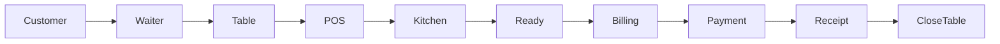
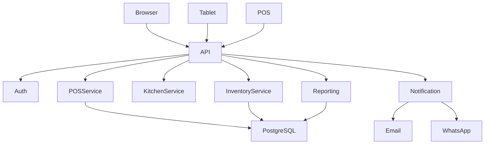

# 01_Product_Vision_and_Requirements.md

# Restaurant POS & Inventory Management System
## Product Vision & Requirements (Enterprise PRD)

> Version: 1.0
> Status: Draft
> Source: Expanded from the approved Statement of Work (SOW)

---

# 1. Document Purpose

This document defines the business vision, functional scope, product goals, user personas, business assumptions, high-level architecture, functional modules, success metrics, and guiding principles for the Restaurant POS platform.

This document is the **foundation** for all subsequent documentation including:
- UX Specifications
- Screen Specifications
- API Specifications
- Database Design
- Workflows
- QA
- UAT

---

# 2. Product Vision

Build a cloud-native, scalable Restaurant POS and Operations platform that enables restaurants to manage sales, dine-in operations, takeaway, kitchen execution, inventory, purchasing, reporting, and administration from a single application.

The system should minimize manual operations, reduce billing time, improve stock visibility, and provide real-time operational intelligence.

---

# 3. Business Objectives

## Primary Objectives

- Complete billing within 30 seconds
- Reduce kitchen communication delays
- Improve inventory accuracy
- Reduce food wastage
- Provide complete auditability
- Enable multi-branch expansion
- Support offline-first operations
- Deliver near real-time dashboards

## Success Metrics

| KPI | Target |
|------|----------|
| Billing Time | <30 sec |
| KOT Delivery | <2 sec |
| Table Turnaround | Improve by 20% |
| Inventory Variance | <2% |
| System Availability | 99.9% |
| Shift Closing Time | <10 min |

---

# 4. Product Scope

## Included

- Authentication
- RBAC
- Menu Management
- Dine-In
- Takeaway
- KOT
- Kitchen Display
- Payments
- Cashier Shift
- Purchase
- Inventory
- Reports
- Dashboard
- Audit Trail

## Future Phases

- QR Ordering
- Loyalty
- CRM
- Delivery Aggregators
- Recipe/BOM
- AI Forecasting

---

# 5. Stakeholders

## Owner
Responsible for configuration, profitability, reports, approvals.

## Restaurant Manager
Daily operations, staff, inventory, approvals.

## Cashier
Billing, payments, shift closing.

## Waiter
Table management and customer orders.

## Kitchen Staff
Food preparation through KOT.

## Stock Controller
Purchases, stock count, adjustments.

## Accountant
Financial reconciliation and exports.

---

# 6. Core Product Principles

1. Minimal Clicks
2. Fast POS
3. Offline-first
4. Secure by Design
5. Event-driven Architecture
6. Modular Services
7. Audit Everything
8. API-first
9. Multi-Branch Ready
10. Extensible

---

# 7. Functional Modules

## Authentication
- Login
- PIN
- Session
- Password Policy
- Device Registration

## POS
Responsibilities:
- Billing
- Discounts
- Payments
- Hold/Recall
- Receipt

Dependencies:
- Menu
- Tables
- Kitchen
- Payments

## Kitchen
Responsibilities:
- Receive KOT
- Update Status
- Reprint
- Cancel Approval

## Inventory
Responsibilities:
- Stock Ledger
- Counts
- Variance
- Valuation

Business Formula:

Available = Opening + Purchases

Used = Available - Physical

Gross Profit = Sales - Consumption Cost

---

# 8. Business Assumptions

- One active order per table.
- Paid bills cannot be edited.
- Every financial action is auditable.
- Discounts beyond limit require approval.
- Inventory period is locked after approval.
- KOT cancellation after preparation requires manager approval.
- Sequential numbering is branch specific.

---

# 9. High-Level User Journey

---

# 10. High-Level Architecture

---

# 11. Risks

- Printer Failure
- Internet Loss
- Incorrect Stock Counts
- Concurrent Billing
- Card Terminal Failure
- Human Error

Mitigation:
- Offline queue
- Retry
- Audit logs
- Approval workflows
- Automatic recovery

---

# 12. Non Functional Requirements

Performance
- API <300ms average
- POS interaction <2 seconds

Security
- JWT
- RBAC
- Encryption

Scalability
- 500+ outlets
- Horizontal scaling

Availability
- 99.9%

Backup
- Daily backup
- Point-in-time recovery

---

# 13. Acceptance Criteria

The product shall:

- Support Dine-In and Takeaway.
- Record every financial transaction.
- Maintain inventory automatically.
- Produce audit logs.
- Export reports.
- Support multiple branches.
- Support configurable permissions.

---

# 14. Dependencies

This document is referenced by:

02_User_Personas.md

03_User_Journey.md

04_Screen_Specifications.md

05_Workflows.md

06_Database.md

07_API.md

08_QA.md

09_UAT.md

---

# 15. Next Documents

1. User Personas
2. User Journeys
3. Information Architecture
4. Navigation
5. Screen Specifications
6. Database
7. APIs
8. Business Rules
9. QA
10. UAT

