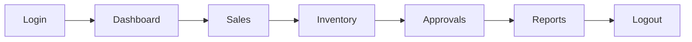
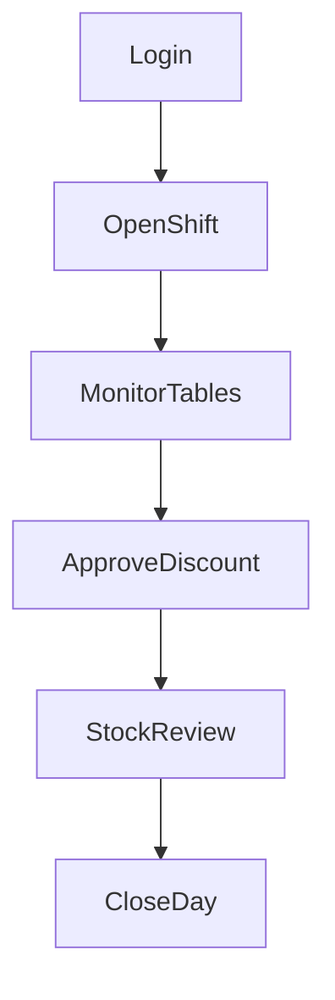
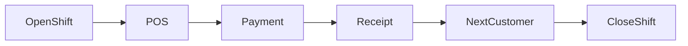
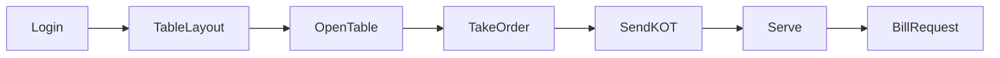
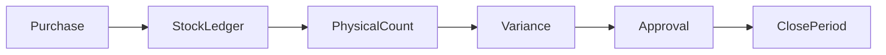
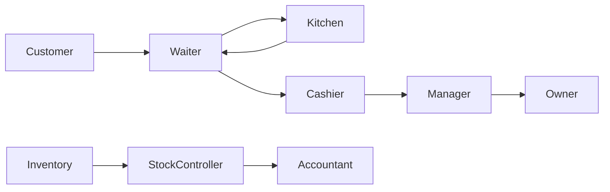

# 02_User_Personas.md

# Restaurant POS Enterprise Product Bible
## User Personas & End-to-End User Journeys

Version: 1.0

---

# Purpose

This document defines every primary actor interacting with the Restaurant POS system.

For each persona the document covers:

- Responsibilities
- Goals
- KPIs
- Permissions
- Daily Journey
- Screen Usage
- Business Rules
- Decision Points
- Notifications
- Exception Scenarios
- Recovery Flow
- Future Enhancements

---

# Persona Matrix

| Persona | Primary Goal | Primary Module |
|---|---|---|
| Owner | Business profitability | Dashboard |
| Restaurant Manager | Operations | Dashboard / Inventory |
| Cashier | Fast billing | POS |
| Waiter | Order management | Table / POS |
| Kitchen Staff | Food preparation | KDS |
| Stock Controller | Inventory accuracy | Inventory |
| Accountant | Financial reports | Reports |
| System Administrator | Configuration | Admin |

---

# 1. Owner

## Objectives
- Monitor daily sales
- Review profitability
- Approve critical transactions
- Monitor branches
- Configure business settings

## Success KPIs
- Revenue
- Gross Profit
- Food Cost %
- Inventory Variance
- Average Order Value
- Table Turnover

## Primary Screens
1. Dashboard
2. Sales Reports
3. Inventory Reports
4. Approval Queue
5. User Management
6. Settings

## Daily Journey

## Business Rules
- Can access all branches.
- Can reopen locked inventory periods.
- Can override manager approvals.
- Can disable users immediately.

## Notifications
- High refund value
- Inventory variance
- Low stock
- Cash mismatch
- Failed backups

## Exception Handling
- Dashboard unavailable → fallback report cache.
- Branch offline → show last sync time.

---

# 2. Restaurant Manager

## Responsibilities
- Shift supervision
- Staff allocation
- Discount approvals
- Refund approvals
- Inventory review

## Journey

## Decisions
- Approve/Reject refund
- Approve void
- Approve stock adjustment

## KPIs
- Shift Sales
- Kitchen SLA
- Customer Wait Time
- Refund %
- Wastage %

---

# 3. Cashier

## Responsibilities
- Billing
- Payment
- Receipt printing
- Shift opening
- Shift closing

## Workflow

## Screen Usage
- Login
- Shift
- POS
- Payment
- Refund
- Reports

## Business Rules
- Cannot edit paid bills.
- Cannot exceed discount limit.
- Refund requires approval.
- Duplicate payment prevented.

## Edge Cases
- Card timeout
- Printer offline
- Mixed payment failure
- Duplicate receipt request

---

# 4. Waiter

## Responsibilities
- Allocate tables
- Capture orders
- Send KOT
- Serve food
- Generate bill request

## Journey

## Permissions
- Create order
- Add items
- Add remarks
- Transfer table (if allowed)

Cannot:
- Refund
- Void
- Delete KOT after preparation

---

# 5. Kitchen Staff

## Responsibilities
- View KOT
- Prepare food
- Update status

## States
New
Preparing
Ready
Served

## KPIs
- Average preparation time
- Delayed orders
- Cancelled items

---

# 6. Stock Controller

## Responsibilities
- Purchase entry
- Physical stock count
- Variance review
- Stock adjustments

## Workflow

Business Rules:
- Negative stock blocked unless configured.
- Approved count locks the period.

---

# 7. Accountant

## Responsibilities
- Financial reconciliation
- Export reports
- Audit review

Reports Used
- Sales
- Purchases
- Inventory
- Profitability
- Cashier Shift

---

# 8. System Administrator

Responsibilities
- User management
- Role management
- Branch setup
- Printer configuration
- Security policies

Critical Rules
- Every action audited.
- Password policy enforced.
- Session timeout configurable.

---

# Cross Persona Interaction

---

# Notification Matrix

| Event | Recipient |
|---|---|
| Order Ready | Waiter |
| Refund Pending | Manager |
| High Discount | Manager |
| Low Stock | Stock Controller |
| Cash Difference | Manager |
| Inventory Closed | Owner |
| Shift Closed | Accountant |

---

# Acceptance Criteria

- Every persona has a unique role.
- RBAC enforced for every screen.
- Unauthorized operations are blocked.
- All approval actions are auditable.
- Journeys complete without role ambiguity.

---

# Dependencies

Next document:

03_Information_Architecture.md

Referenced by:
- Screen Specifications
- API Specifications
- Permission Matrix
- Business Rules
