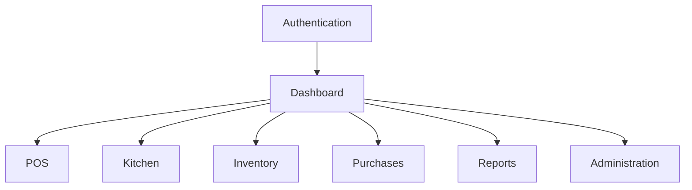
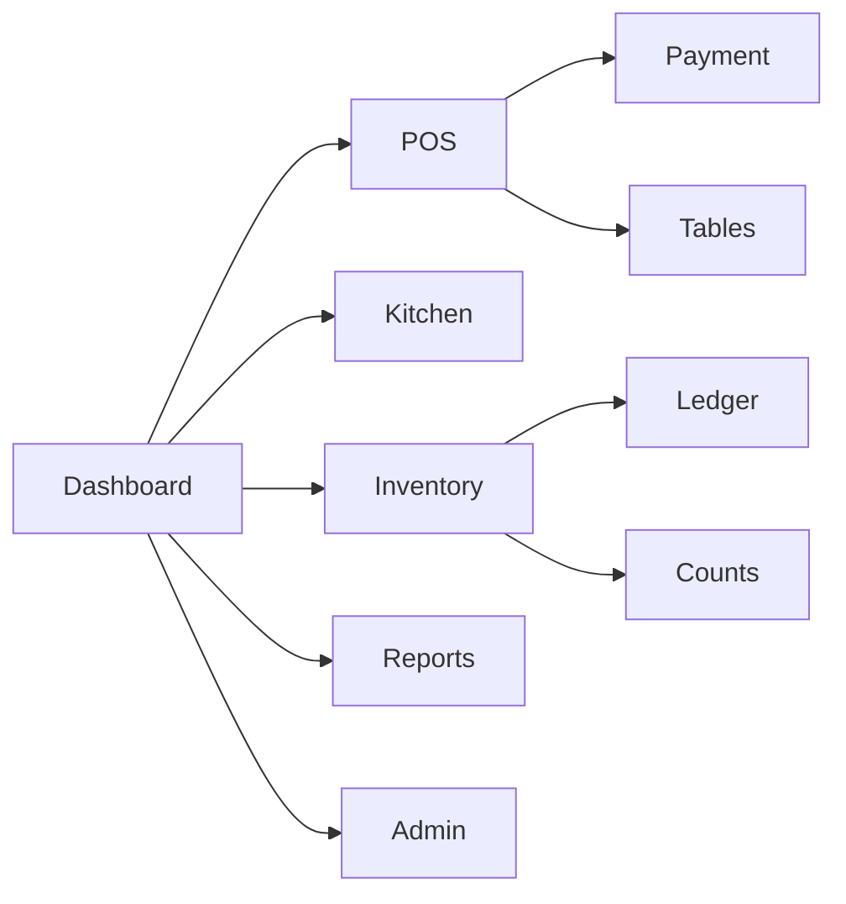
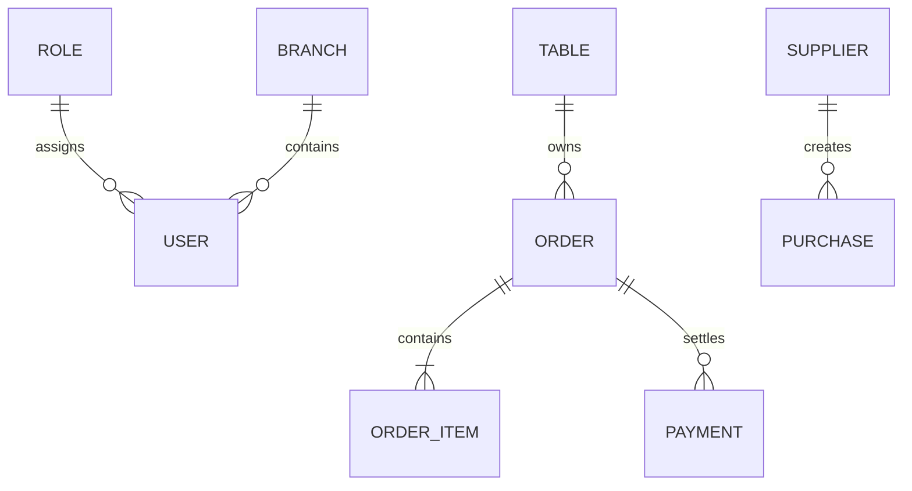
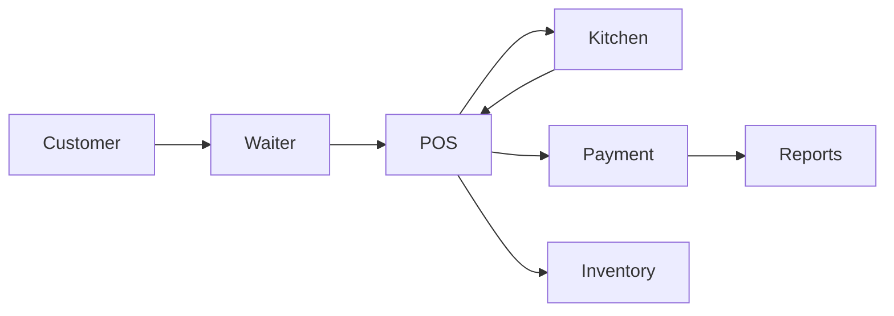

# 03_Information_Architecture.md

# Restaurant POS Enterprise Product Bible
## Information Architecture (IA)

## Purpose
Defines the complete Information Architecture for the Restaurant POS platform and serves as the foundation for UX, APIs, database, navigation, RBAC, QA and UAT.

## Product Architecture

## Core Modules
1. Authentication
2. Dashboard
3. POS
4. Table Management
5. Takeaway
6. Kitchen Display
7. Payments
8. Cashier Shift
9. Purchases
10. Inventory
11. Reports
12. Administration
13. Notifications
14. Audit Logs

## Screen Inventory

### Authentication
- Login
- Forgot Password
- Session Lock

### Dashboard
- Executive Dashboard
- Operations Dashboard
- Kitchen Dashboard

### POS
- Quick Billing
- Dine-In
- Takeaway
- Hold Orders
- Recall Orders
- Payment
- Receipt Preview

### Tables
- Floor Layout
- Transfer
- Merge
- Split

### Kitchen
- New Orders
- Preparing
- Ready
- Completed

### Inventory
- Stock Ledger
- Stock Count
- Variance
- Adjustments
- Valuation

### Purchases
- Purchase Entry
- Supplier
- Purchase Returns

### Reports
- Sales
- Inventory
- Purchase
- Cashier
- GP Report

### Admin
- Users
- Roles
- Branches
- Taxes
- Printers
- Settings

## Navigation

Navigation Rules:
- Maximum three clicks to operational screens.
- Dashboard always accessible.
- RBAC controlled menu visibility.
- Breadcrumb on every page.

## Entity Relationship Overview

Core Entities:
- Users
- Roles
- Branches
- Menu
- Tables
- Orders
- Order Items
- Payments
- KOT
- Purchases
- Inventory
- Stock Ledger
- Audit Logs

## UX Principles
- Minimal clicks
- Fast search
- Tablet friendly
- Keyboard shortcuts
- Responsive layouts
- Inline validation

## Data Flow

## Module Dependencies

| Module | Depends On |
|---|---|
| POS | Auth, Menu, Tables |
| Kitchen | POS |
| Inventory | Purchases |
| Reports | POS, Inventory |
| Admin | Auth |

## Scalability
- Multi-branch
- Central warehouse
- Delivery integrations
- AI services
- Mobile apps

## Acceptance Criteria
- Every feature mapped to a module.
- Every screen reachable through navigation.
- RBAC enforced.
- Future modules can be added without restructuring.

## Next
- 04_Navigation_Hierarchy.md
- 05_User_Journeys.md
- 06_Screen_Specifications.md
