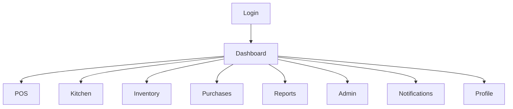
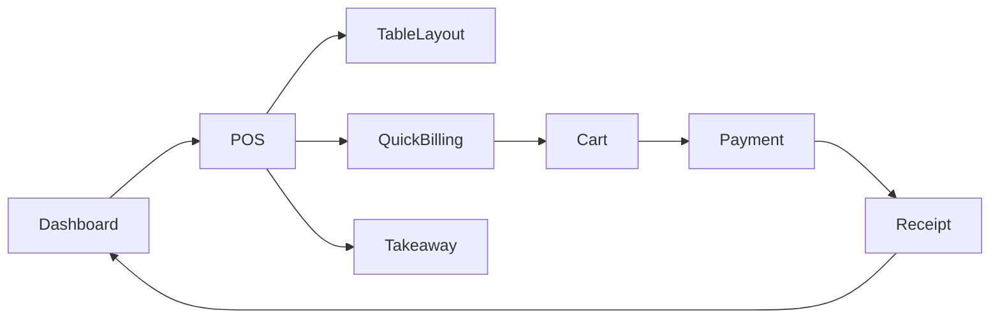
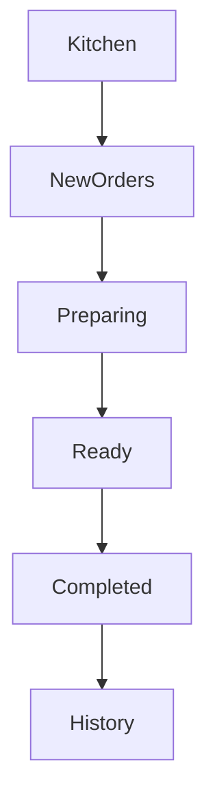
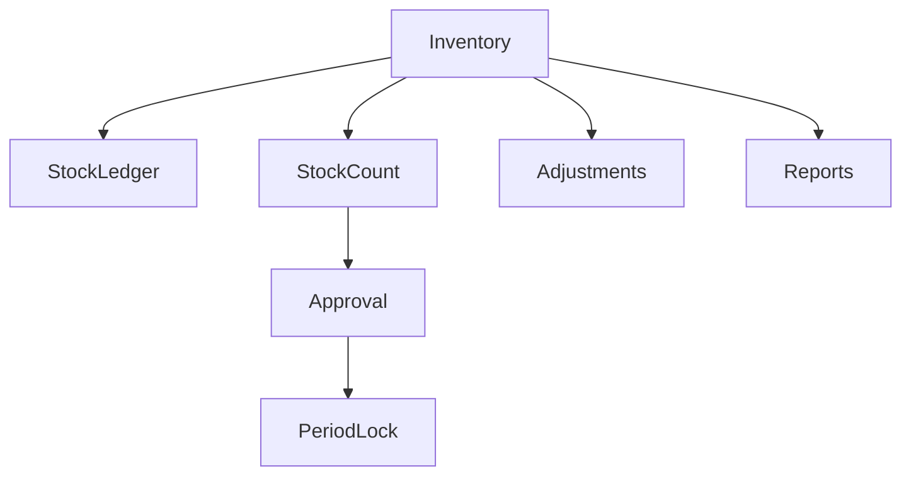

# 04_Navigation_Hierarchy.md

# Restaurant POS Enterprise Product Bible
## Navigation Hierarchy & Navigation Rules

Version: 1.0

---

# 1. Purpose

This document defines the complete navigation architecture for the Restaurant POS platform, ensuring every user can reach required functionality efficiently while enforcing role-based access.

---

# 2. Navigation Principles

- Maximum 3 clicks to operational screens.
- Dashboard is the primary landing page after login.
- Context-sensitive navigation based on role.
- Breadcrumbs on all management screens.
- Frequently used actions accessible from shortcuts.
- Destructive actions require confirmation.

---

# 3. Global Navigation

---

# 4. Role Based Navigation

| Role | Default Landing Page | Accessible Modules |
|------|----------------------|--------------------|
| Owner | Executive Dashboard | All |
| Manager | Operations Dashboard | POS, Kitchen, Inventory, Reports |
| Cashier | POS | POS, Payments, Shift |
| Waiter | Table Layout | Tables, POS |
| Kitchen | Kitchen Display | Kitchen |
| Stock Controller | Inventory | Purchases, Inventory |
| Accountant | Reports | Reports, Exports |
| Admin | Admin Dashboard | Configuration |

---

# 5. POS Navigation

Navigation Rules

- Dine-In requires table selection.
- Takeaway bypasses table layout.
- Payment only after order validation.
- Receipt shown after successful payment.
- Return to Dashboard after transaction completion.

---

# 6. Kitchen Navigation

Rules

- Cannot skip directly from New to Completed.
- Cancel requires approval after preparation starts.

---

# 7. Inventory Navigation

---

# 8. Purchase Navigation

Supplier List
→ Purchase Entry
→ Review
→ Save
→ Stock Update
→ Ledger

---

# 9. Administration Navigation

Admin
├── Users
├── Roles
├── Branches
├── Taxes
├── Receipt Templates
├── Printers
├── Business Settings
└── Audit Logs

---

# 10. Breadcrumb Strategy

Examples

Dashboard > POS > Dine-In > Table 12

Dashboard > Inventory > Stock Count > Session #102

Dashboard > Reports > Sales > Daily Sales

---

# 11. Navigation Guards

| Action | Validation |
|--------|------------|
| Open POS | Active Shift Required |
| Payment | Order Exists |
| Inventory Count | Permission Required |
| Reopen Count | Admin Approval |
| Refund | Manager Approval |
| Admin Settings | Admin Role |

---

# 12. Deep Links

Supported

- /dashboard
- /pos
- /pos/dine-in
- /pos/takeaway
- /inventory
- /reports/sales
- /admin/users

Rules

- Authentication mandatory.
- Role validation before page load.
- Unauthorized access redirects to Access Denied.

---

# 13. Modal Navigation

POS
→ Discount Modal
→ Manager Approval
→ Return to POS

Inventory
→ Adjustment Modal
→ Save
→ Ledger Refresh

Payment
→ Split Payment
→ Success
→ Receipt

---

# 14. Mobile & Tablet Navigation

Tablet
- Left navigation rail
- Floating action buttons
- Touch optimized controls

Mobile
- Bottom navigation
- Simplified menus
- Swipe actions for operational tasks

Desktop
- Sidebar navigation
- Keyboard shortcuts
- Multi-panel layouts

---

# 15. Error Navigation

Session Expired
→ Login

Printer Offline
→ Retry / Continue Without Print

Network Offline
→ Offline Queue

Permission Denied
→ Access Denied Screen

---

# 16. Acceptance Criteria

- Every screen has a defined entry and exit path.
- Navigation is role-aware.
- No orphan screens exist.
- Maximum three clicks to operational tasks.
- Breadcrumbs available on management pages.
- Guards prevent unauthorized operations.

---

# Next Document

05_User_Journeys.md

This document will contain detailed end-to-end journeys, alternate flows, decision trees, business logic, recovery paths, and Mermaid diagrams for every persona and every major workflow.
