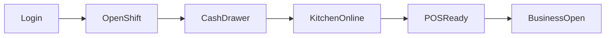
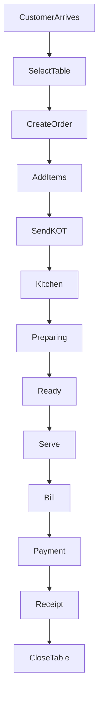
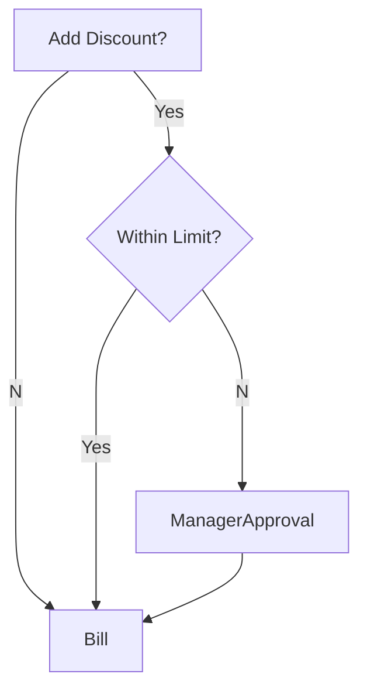
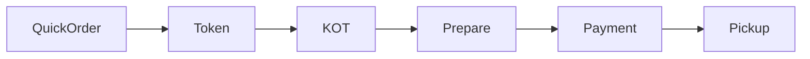
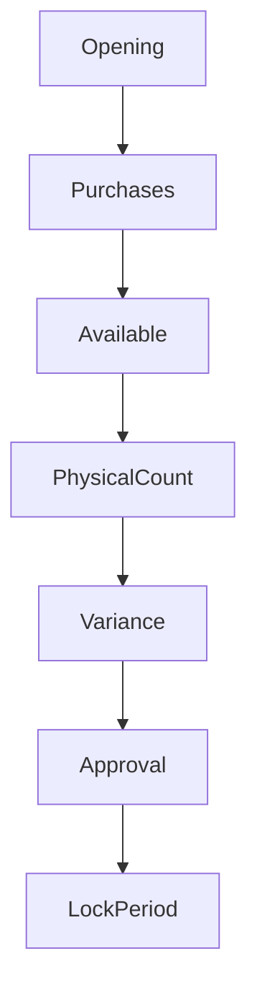

# 05_User_Journeys.md

# Restaurant POS Enterprise Product Bible
## End-to-End User Journeys & Business Flows

Version: 1.0

---

# Purpose

This document defines complete user journeys for every primary actor. Each journey includes:
- Happy Path
- Alternate Paths
- Exception Paths
- Recovery Paths
- Business Logic
- Validation Rules
- Decision Points
- Notifications
- APIs
- Database Entities
- Audit Events

---

# Journey Catalog

| ID | Journey |
|----|---------|
| UJ-001 | Restaurant Opening |
| UJ-002 | Dine-In Order |
| UJ-003 | Additional KOT |
| UJ-004 | Table Transfer |
| UJ-005 | Merge Tables |
| UJ-006 | Split Bill |
| UJ-007 | Takeaway |
| UJ-008 | Payment |
| UJ-009 | Refund |
| UJ-010 | Shift Closing |
| UJ-011 | Purchase Entry |
| UJ-012 | Stock Count |
| UJ-013 | Inventory Closing |

---

# UJ-001 Restaurant Opening

## Actors
Manager, Cashier, Kitchen

Business Rules
- Previous shift must be closed unless override.
- Cashier enters opening cash.
- Kitchen printers/KDS health check before opening.

Edge Cases
- Previous shift not closed.
- Printer unavailable.
- Network offline.
- Cash mismatch.

---

# UJ-002 Dine-In Order

## Goal
Serve a customer from seating to payment.

### Detailed Business Logic

1. Waiter selects available table.
2. System creates Order (Draft).
3. Items added with modifiers.
4. Validation:
   - Item active.
   - Price available.
   - Kitchen section mapped.
5. KOT generated only for unsent items.
6. Additional items generate incremental KOT.
7. Payment locks order.
8. Receipt generated.
9. Table status changes to Available after successful payment.

### Decision Tree

### APIs
GET /tables
GET /menu
POST /orders
POST /orders/{id}/items
POST /kot
POST /payments

### Database
Orders
OrderItems
Tables
KOT
Payments
AuditLogs

### Audit Events
- Order Created
- Item Added
- KOT Sent
- Discount Approved
- Payment Completed
- Receipt Printed

### Notifications
Kitchen: New KOT
Manager: Discount Approval
Customer: Receipt (optional)

### Exception Paths
- Kitchen printer offline
- Duplicate click
- Table occupied by another user
- Item unavailable
- Session timeout

### Recovery
- Retry KOT
- Save draft locally
- Resume unpaid order

---

# UJ-003 Additional KOT

Flow:
Existing Order
→ Add Items
→ Send Incremental KOT
→ Kitchen Receives Only New Items

Rules
- Previous KOT immutable.
- Deleted prepared items require approval.

---

# UJ-004 Table Transfer

Rules
- Destination table must be available.
- Audit source and destination.
- Preserve order history.

Edge Cases
- Destination occupied.
- Payment already initiated.

---

# UJ-005 Merge Tables

Rules
- Same branch.
- Both unpaid.
- Taxes recalculated.
- KOT history preserved.

---

# UJ-006 Split Bill

Split Methods
- By Item
- By Quantity
- By Amount
- Equal Split

Business Rules
- Total payable remains unchanged.
- Split receipts linked to original order.

---

# UJ-007 Takeaway

Rules
- Table not required.
- Token generated.
- Pickup status tracked.

---

# UJ-008 Payment

Payment Types
- Cash
- Card
- UPI
- Mixed

Rules
- Duplicate transaction prevention.
- Card reference stored.
- Balance calculated automatically.

Edge Cases
- Card declined.
- Partial payment.
- Gateway timeout.

---

# UJ-009 Refund

Prerequisites
- Original bill exists.
- Manager approval.
- Refund reason mandatory.

Audit
- Before value
- After value
- Approver
- Timestamp

---

# UJ-010 Shift Closing

Manager verifies:
- Cash
- Card
- Refunds
- Voids
- Drawer Difference

If variance > tolerance
→ Approval required.

---

# UJ-011 Purchase Entry

Supplier
→ Invoice
→ Items
→ Save
→ Stock Ledger Update

Validation
- Supplier active.
- Duplicate invoice check.
- Positive quantity.

---

# UJ-012 Stock Count

Formula

Available = Opening + Purchases

Used = Available - Physical

Closing = Physical

---

# UJ-013 Inventory Closing

Business Logic
- Freeze period.
- Generate valuation.
- Calculate GP.
- Create opening for next period.

---

# Common Validation Rules

- No edit after payment.
- Negative quantity blocked.
- Inactive menu hidden.
- Duplicate payment rejected.
- Closed inventory locked.

---

# Common Events

- OrderCreated
- KOTGenerated
- PaymentCompleted
- RefundApproved
- StockAdjusted
- InventoryClosed

---

# Acceptance Criteria

- Every journey defines actor, logic, validations, decisions, APIs, entities, audit events, notifications and recovery.
- All workflows are traceable to business requirements.

Next:
06_Screen_Specifications/
