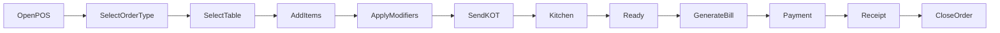
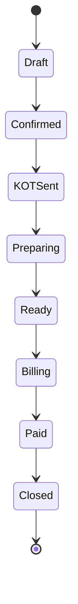

# 06_Screen_Specifications_03_POS_Quick_Billing.md

# Restaurant POS Enterprise Product Bible
## Screen Specification – POS Quick Billing

**Screen ID:** SCR-POS-001  
**Module:** POS

---

# 1. Purpose

The POS Quick Billing screen is the primary operational screen used by Cashiers and Waiters to create Dine-In and Takeaway orders, send Kitchen Order Tickets (KOT), collect payments, and complete transactions in under 30 seconds.

---

# 2. Supported Roles

| Role | Access |
|---|---|
| Cashier | Full |
| Waiter | Create Orders, Send KOT |
| Manager | Full + Override |
| Owner | View/Override |

---

# 3. Business Objectives

- Fast billing
- Accurate pricing
- Real-time kitchen communication
- Inventory traceability
- Zero duplicate billing

---

# 4. Wireframe

```text
+--------------------------------------------------------------------------------+
| Branch | Shift | Cashier | Search Item                          [Profile]       |
+--------------------------------------------------------------------------------+
| Categories         | Menu Grid                              | Current Cart      |
| Breakfast          | Burger | Pizza | Tea | Coffee          | Item  Qty Price   |
| Lunch              | Rice   | Juice | Dessert               | Modifier          |
| Snacks             |                                       | Remarks           |
+--------------------------------------------------------------------------------+
| Customer | Table | Order Type | Discount | Tax | Total | Payment | Send KOT     |
+--------------------------------------------------------------------------------+
| Hold | Recall | Split Bill | Split Payment | Print | Cancel | Complete Order   |
+--------------------------------------------------------------------------------+
```

---

# 5. Functional Components

- Item Search
- Category Filter
- Menu Grid
- Cart
- Modifiers
- Remarks
- Customer Lookup
- Table Selector
- Discount
- Tax Summary
- Payment
- Hold/Recall
- Send KOT
- Print

---

# 6. Complete Workflow



---

# 7. Business Logic

## Order Creation
1. Generate Draft Order.
2. Assign Branch.
3. Assign Shift.
4. Assign Waiter/Cashier.
5. Set Order Type.

## Pricing Engine
Net Price =
Base Price
+ Modifier Price
- Item Discount
+ Tax

Grand Total =
Sum(All Items)
- Bill Discount
+ Service Charge
+ Tax
± Rounding

## KOT Logic
- Only unsent items generate KOT.
- New items generate incremental KOT.
- Cancelled prepared items require manager approval.

## Payment Logic
- Cash
- Card
- UPI
- Wallet
- Mixed

Duplicate payment blocked using transaction lock.

---

# 8. Validation Rules

- Table mandatory for Dine-In.
- Token mandatory for Takeaway.
- Inactive items hidden.
- Zero quantity blocked.
- Negative price blocked.
- Paid order immutable.
- Discount > limit requires approval.
- Payment must equal payable amount.

---

# 9. State Machine



---

# 10. APIs

## GET /menu
Load menu.

## GET /tables
Load available tables.

## POST /orders
Create order.

## POST /orders/{id}/items
Add items.

## POST /kot
Generate KOT.

## POST /payments
Complete payment.

## GET /receipts/{id}
Generate receipt.

---

# 11. Database Tables

- orders
- order_items
- menu_items
- modifiers
- taxes
- tables
- kot
- payments
- receipts
- audit_logs

---

# 12. Events

- OrderCreated
- ItemAdded
- KOTGenerated
- PaymentCompleted
- ReceiptPrinted
- OrderClosed

---

# 13. Notifications

- Kitchen receives KOT
- Manager approval request
- Payment failure alert
- Low stock warning

---

# 14. Edge Cases

1. Double-click payment
2. Duplicate KOT
3. Network interruption
4. Printer offline
5. Kitchen printer unavailable
6. Item becomes inactive during billing
7. Table occupied by another terminal
8. Card declined
9. Partial payment cancelled
10. Shift closed during billing
11. Tax configuration missing
12. Modifier deleted after selection
13. Browser refresh during payment
14. Session timeout
15. Cash drawer disconnected

---

# 15. Offline Behaviour

- Orders stored locally.
- Queue KOT until connectivity restored.
- Prevent duplicate sync using UUID.
- Payments require reconciliation after reconnect.

---

# 16. Audit Trail

Every action logs:
- User
- Device
- Timestamp
- Branch
- Before/After values
- Approval reference

---

# 17. Performance

- Menu load <2 sec
- Item search <300 ms
- Payment <2 sec
- KOT dispatch <2 sec

---

# 18. Acceptance Criteria

- Cashier completes standard bill within 30 seconds.
- KOT generated only once per item.
- Payment cannot exceed outstanding amount.
- Receipt always linked to payment.
- All financial actions auditable.

---

# Next Screen

06_Screen_Specifications_04_Table_Layout.md
