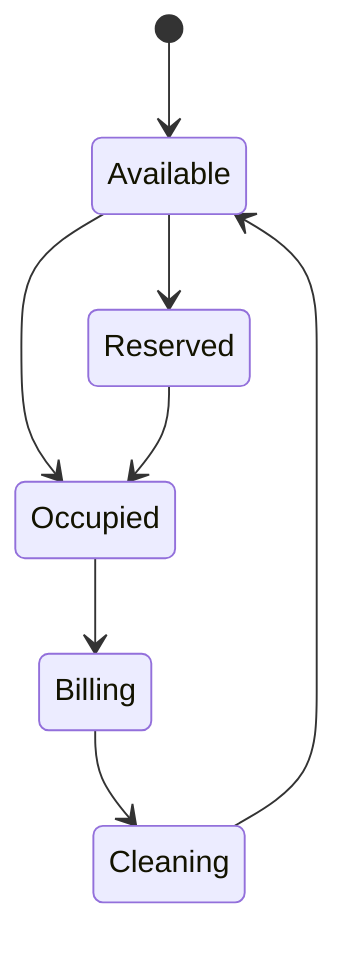
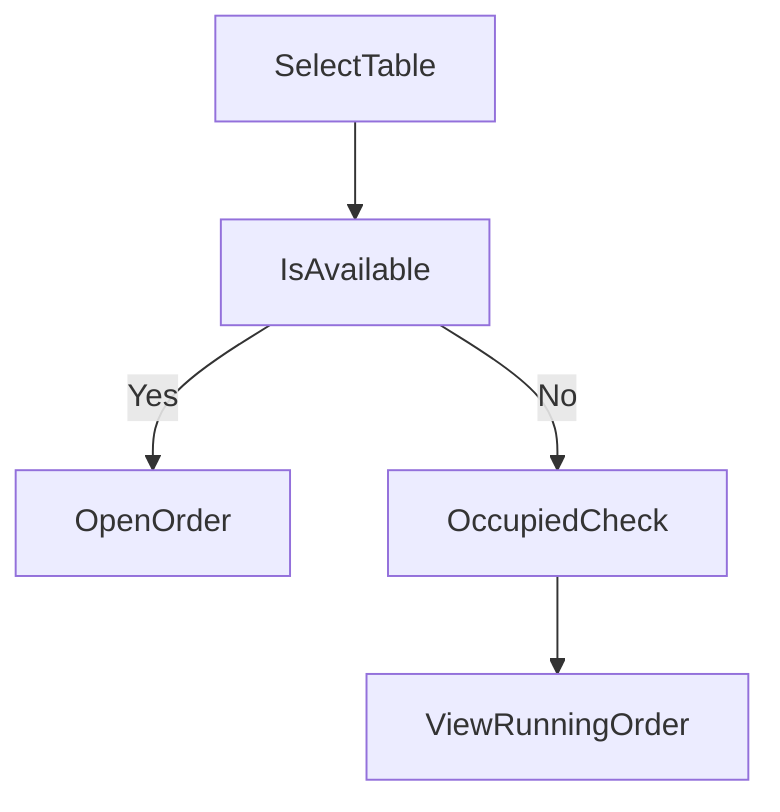

# 06_Screen_Specifications_04_Table_Layout.md

# Restaurant POS Enterprise Product Bible
## Screen Specification – Table Layout & Floor Management

**Screen ID:** SCR-TBL-001
**Module:** Table Management

---

# 1. Purpose

The Table Layout screen provides a real-time visual representation of the restaurant floor. It enables waiters and managers to allocate tables, monitor occupancy, transfer guests, merge tables, split bills, and track dining duration.

---

# 2. Actors

| Role | Permissions |
|---|---|
| Waiter | Open assigned tables, create orders |
| Cashier | View tables, generate bills |
| Manager | Transfer, merge, override, reserve |
| Owner | View all |
| Admin | Configure layout |

---

# 3. Business Goals

- Visual occupancy management
- Reduce table wait time
- Prevent duplicate seating
- Improve table turnover
- Enable real-time collaboration

---

# 4. Wireframe

```text
+------------------------------------------------------------------------+
| Floor: Ground ▼   Refresh   Legend                                     |
+------------------------------------------------------------------------+
| 🟢 Available   🔴 Occupied   🟡 Reserved   🔵 Billing   ⚫ Cleaning      |
+------------------------------------------------------------------------+
| T01   T02   T03   T04   T05                                            |
| T06   T07   T08   T09   T10                                            |
| VIP1  VIP2  BAR1  BAR2                                                  |
+------------------------------------------------------------------------+
| Selected Table: T08                                                 |
| Waiter: Rahul     Guests: 4     Running Time: 00:43                  |
| [Open] [Transfer] [Merge] [Split] [Reserve] [Generate Bill]          |
+------------------------------------------------------------------------+
```

---

# 5. Table States



## State Definitions

- Available – Ready for seating
- Reserved – Reserved for future guest
- Occupied – Active order
- Billing – Payment in progress
- Cleaning – Awaiting housekeeping

---

# 6. Business Logic

### Open Table
- Table must be Available.
- Creates draft order.
- Assign waiter automatically or manually.

### Reserve Table
- Reservation date/time mandatory.
- Cannot reserve occupied table.

### Transfer Table
- Destination must be Available.
- Entire order transferred.
- Audit source and destination.

### Merge Tables
- Same branch.
- Both unpaid.
- Preserve KOT history.
- Recalculate seating capacity.

### Split Bill
- Split by Item
- Split by Quantity
- Split by Percentage
- Equal Split

---

# 7. Decision Logic



---

# 8. Validation Rules

- Table number unique.
- Capacity > 0.
- Only one active order per table.
- Paid tables cannot merge.
- Reserved tables cannot be transferred.
- Table status updates in real time.

---

# 9. APIs

GET /floors
GET /tables
POST /tables/open
POST /tables/transfer
POST /tables/merge
POST /tables/split
POST /tables/reserve
GET /tables/{id}

---

# 10. Database Tables

- floors
- tables
- table_reservations
- orders
- order_items
- waiters
- audit_logs

---

# 11. WebSocket Events

TableOpened
TableClosed
TableTransferred
TableMerged
TableReserved
TableReleased
BillStarted

---

# 12. Concurrency Rules

Scenario: Two waiters click the same table.

Rule:
- First transaction acquires optimistic lock.
- Second user receives:
  "Table is currently occupied by another user."

Lock released after transaction commit.

---

# 13. Notifications

- Reserved table due in 15 min
- VIP guest seated
- Long-running table (>90 min)
- Billing pending >10 min

---

# 14. Edge Cases

1. Two waiters opening same table
2. Browser refresh during transfer
3. Merge while payment initiated
4. Reserved table walk-in
5. Cleaning not completed
6. Table deleted after layout loaded
7. Network loss during merge
8. Transfer to inactive table
9. Capacity exceeded warning
10. Duplicate reservation
11. Order already closed
12. Split bill after partial payment
13. Table moved across floors
14. Floor disabled
15. Offline terminal conflict

---

# 15. Offline Behaviour

- Cache floor layout.
- Queue table updates.
- Resolve conflicts using latest approved transaction.
- Refresh status after reconnect.

---

# 16. Audit Trail

Capture:
- Table status change
- Waiter assignment
- Transfer
- Merge
- Split
- Reservation
- Manual override

---

# 17. Performance

- Layout load <2 sec
- Table refresh <500 ms
- WebSocket update <1 sec

---

# 18. QA Scenarios

TC-001 Open available table
Expected: Draft order created.

TC-002 Transfer occupied table
Expected: Order moved successfully.

TC-003 Merge paid table
Expected: Operation blocked.

TC-004 Concurrent table open
Expected: Single successful transaction.

---

# 19. UAT Acceptance Criteria

- Staff can identify table status instantly.
- Transfer completes without data loss.
- Merge preserves KOT history.
- Table status synchronizes across all terminals.
- No duplicate active orders exist.

---

# Next Screen

06_Screen_Specifications_05_Dine_In_Order.md
