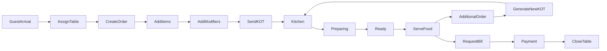
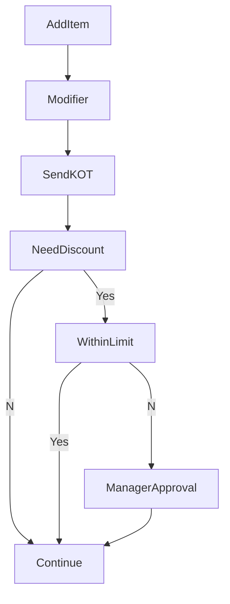
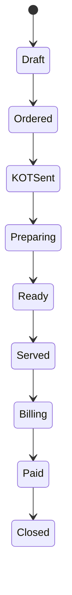

# 06_Screen_Specifications_05_Dine_In_Order.md

# Restaurant POS Enterprise Product Bible
## Screen Specification – Dine-In Order Management

**Screen ID:** SCR-DINE-001  
**Module:** Dine-In Operations

---

# 1. Purpose

The Dine-In Order screen manages the complete lifecycle of a restaurant table order—from guest seating to order completion. It coordinates waitstaff, kitchen, cashier, inventory, pricing, taxation, and billing while ensuring data consistency and real-time updates.

---

# 2. Business Objectives

- Reduce order-taking time to under 2 minutes.
- Eliminate duplicate orders.
- Ensure accurate KOT routing.
- Track table occupancy and service time.
- Support incremental ordering without affecting previous KOTs.

---

# 3. Actors

- Waiter
- Restaurant Manager
- Kitchen Staff
- Cashier
- Owner (View)

---

# 4. End-to-End Workflow



---

# 5. Screen Layout

```text
+--------------------------------------------------------------------------------------+
| Table: T12 | Waiter: Rahul | Guests:4 | Duration: 00:21                              |
+--------------------------------------------------------------------------------------+
| Categories | Menu | Search | Cart | Running Total | Remarks | Modifier | Seat No.   |
+--------------------------------------------------------------------------------------+
| Add Item | Send KOT | Hold | Recall | Transfer | Merge | Split | Bill | Payment     |
+--------------------------------------------------------------------------------------+
```

---

# 6. Business Logic

## Order Creation
- One active order per table.
- Order starts in Draft state.
- Waiter automatically assigned.
- Timestamp captured.

## Menu Logic
- Only active menu items displayed.
- Category filtering.
- Partial search.
- Favorites shown first.

## Modifier Engine
Supports:
- Spice Level
- Cooking Preference
- Add-ons
- Removal of ingredients
- Portion Size

Modifier price updates item total instantly.

## Seat-wise Ordering
Optional configuration.

Each item may belong to:
- Seat 1
- Seat 2
- Shared Table

## Course-wise Ordering
Courses:
- Starter
- Main Course
- Dessert
- Beverage

Kitchen receives course sequence.

---

# 7. KOT Rules

- Only unsent items appear in next KOT.
- Previous KOT immutable.
- Edited items after KOT require manager approval.
- Cancelled prepared items generate Cancel KOT.

---

# 8. Pricing Engine

```
Item Total =
(Base Price
+ Modifier Cost)
× Quantity

Bill Total =
Item Totals
- Item Discounts
- Bill Discount
+ Service Charge
+ Tax
± Rounding
```

---

# 9. Decision Logic



---

# 10. State Machine



---

# 11. APIs

- GET /menu
- GET /tables/{id}
- POST /orders
- POST /orders/{id}/items
- PATCH /orders/{id}/items
- DELETE /orders/{id}/items
- POST /kot
- POST /discount/approve
- POST /bill
- POST /payment

---

# 12. Database Tables

- orders
- order_items
- menu_items
- modifiers
- kot
- tables
- taxes
- discounts
- payments
- audit_logs

---

# 13. Events

- OrderCreated
- ItemAdded
- ModifierApplied
- KOTGenerated
- KitchenAccepted
- FoodReady
- BillRequested
- PaymentCompleted
- TableReleased

---

# 14. Notifications

- New KOT to Kitchen
- Food Ready to Waiter
- Discount Approval to Manager
- Long Running Table Alert
- Kitchen Delay Alert

---

# 15. Validation Rules

- Table required.
- Quantity > 0.
- Menu active.
- Modifier valid.
- Kitchen section mapped.
- Duplicate KOT prevented.
- Paid order cannot be edited.

---

# 16. Edge Cases

1. Duplicate item clicks.
2. Item removed after KOT.
3. Kitchen printer offline.
4. Waiter changes during order.
5. Table transferred after first KOT.
6. Discount requested after payment initiated.
7. Modifier deleted by admin during ordering.
8. Browser refresh.
9. Session timeout.
10. Network disconnect before KOT acknowledgement.
11. Order reopened after bill generation.
12. Partial cancellation.
13. Concurrent updates from two devices.
14. Tax configuration changed mid-order.
15. Table merged while kitchen preparing.

---

# 17. Offline Behaviour

- Draft order stored locally.
- Pending KOT queued.
- Conflict resolution by latest confirmed version.
- Sync retries with exponential backoff.

---

# 18. Audit Trail

Log:
- Order create/update
- Item add/remove
- Modifier changes
- KOT generation
- Discount approval
- Bill generation
- Table release

---

# 19. QA Scenarios

TC-001 Create dine-in order.

TC-002 Add modifier.

TC-003 Send incremental KOT.

TC-004 Edit item after KOT.

TC-005 Concurrent waiter update.

---

# 20. UAT Acceptance Criteria

- Waiter completes order entry in under 2 minutes.
- Kitchen receives only new items in additional KOT.
- Totals remain accurate after modifiers and discounts.
- Table status updates in real time.
- Complete audit trail available.

---

# Next Screen

06_Screen_Specifications_06_Takeaway_Order.md
