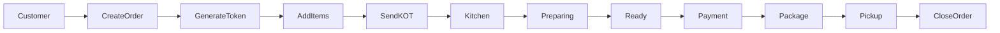
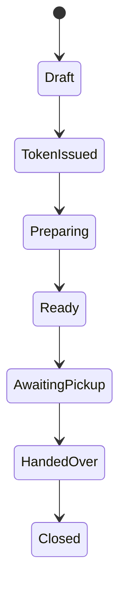
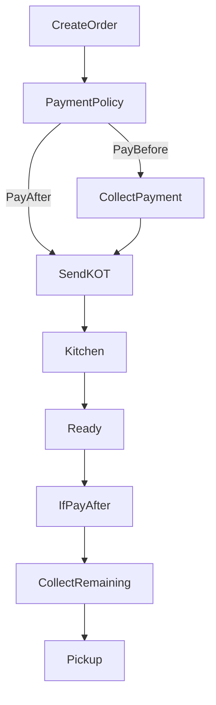

# 06_Screen_Specifications_06_Takeaway_Order.md

# Restaurant POS Enterprise Product Bible
## Screen Specification – Takeaway Order Management

**Screen ID:** SCR-TKO-001
**Module:** Takeaway / Quick Service

---

# 1. Purpose

The Takeaway Order screen enables rapid order creation for customers who are not dining in. It manages token generation, kitchen routing, payment policy, packaging, pickup, and order completion while minimizing queue time.

---

# 2. Business Objectives

- Complete order entry in under 60 seconds.
- Generate unique pickup token.
- Support pay-before and pay-after workflows.
- Minimize customer waiting time.
- Prevent duplicate token issuance.

---

# 3. Actors

- Cashier
- Restaurant Manager
- Kitchen Staff
- Customer (indirect)
- Owner (view)

---

# 4. End-to-End Workflow



---

# 5. Screen Wireframe

```text
+----------------------------------------------------------------------------------+
| Token: Auto | Customer Name | Mobile | ETA | Search Menu                         |
+----------------------------------------------------------------------------------+
| Categories | Menu Grid | Cart | Qty | Modifiers | Remarks                        |
+----------------------------------------------------------------------------------+
| Total | Discount | Tax | Payment | Print Token | Send KOT | Complete             |
+----------------------------------------------------------------------------------+
| Queue Status | Preparing | Ready | Handed Over                                  |
+----------------------------------------------------------------------------------+
```

---

# 6. Business Logic

## Token Generation
- Sequential by branch.
- Optional daily reset.
- Prevent duplicate active token.

## Customer
- Name optional.
- Mobile optional/configurable.
- Existing customer lookup supported.

## Payment Policy
Configuration:
1. Payment Before Preparation.
2. Payment After Preparation.

Rule engine enforces outlet policy.

## Packaging
- Packaging charge configurable.
- Eco-packaging option.
- Package count tracked.

---

# 7. Kitchen Logic

- Route by kitchen section.
- Incremental KOT supported.
- ETA calculated from item prep time.
- Highest priority for paid express orders (optional).

---

# 8. Queue State Machine



---

# 9. Decision Flow



---

# 10. Validation Rules

- At least one item required.
- Token unique.
- Quantity greater than zero.
- Active menu items only.
- Payment mandatory before handover.
- Cancelled order cannot reopen without manager approval.

---

# 11. API Contracts

GET /menu
POST /takeaway/orders
POST /takeaway/token
POST /kot
GET /takeaway/{id}
PATCH /takeaway/status
POST /payments
POST /pickup/complete

---

# 12. Database Tables

- takeaway_orders
- takeaway_items
- tokens
- payments
- kot
- packaging
- audit_logs
- notifications

---

# 13. Events

- TokenGenerated
- TakeawayCreated
- KOTSent
- FoodReady
- PaymentCompleted
- PickupCompleted

---

# 14. Notifications

- Order Ready SMS/WhatsApp (optional)
- Kitchen Delay
- Token Called
- Payment Pending
- Pickup Reminder

---

# 15. Edge Cases

1. Duplicate token generation.
2. Customer leaves before pickup.
3. Kitchen delay beyond SLA.
4. Payment reversal.
5. Token lost by customer.
6. Wrong order handed over.
7. Partial cancellation.
8. Item unavailable after payment.
9. Printer offline.
10. Network failure during payment.
11. Multiple open takeaway orders for same customer.
12. Packaging unavailable.
13. Mobile number entered incorrectly.
14. Pickup after closing time.
15. Order expired before pickup.
16. Token reset conflict.
17. Browser refresh during payment.
18. Duplicate KOT dispatch.
19. Offline terminal synchronization.
20. Queue overload.

---

# 16. Offline Behaviour

- Cache order locally.
- Generate temporary offline token.
- Sync to server after reconnect.
- Resolve duplicate token using server sequence.

---

# 17. Audit Trail

Track:
- Token generation
- Payment
- Status transitions
- Pickup completion
- Order cancellation
- Manager overrides

---

# 18. QA Scenarios

TC-001 Create takeaway order.
TC-002 Pay before preparation.
TC-003 Pay after preparation.
TC-004 Duplicate token prevention.
TC-005 Offline order synchronization.
TC-006 Wrong pickup attempt.

---

# 19. UAT Acceptance Criteria

- Token generated within 1 second.
- Kitchen receives KOT within 2 seconds.
- Customer receives correct packaged order.
- Duplicate token impossible.
- Queue status visible in real time.
- Pickup recorded with complete audit trail.

---

# Next Screen

06_Screen_Specifications_07_Payment.md
