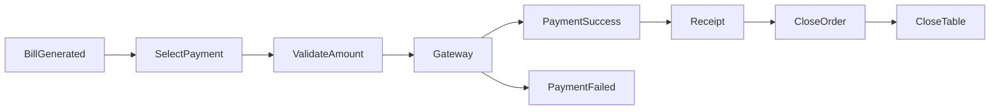
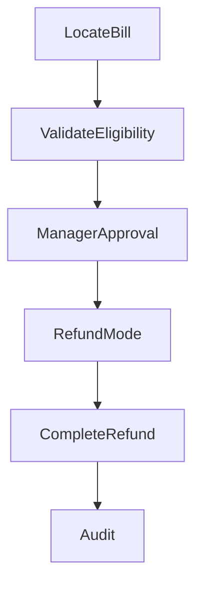
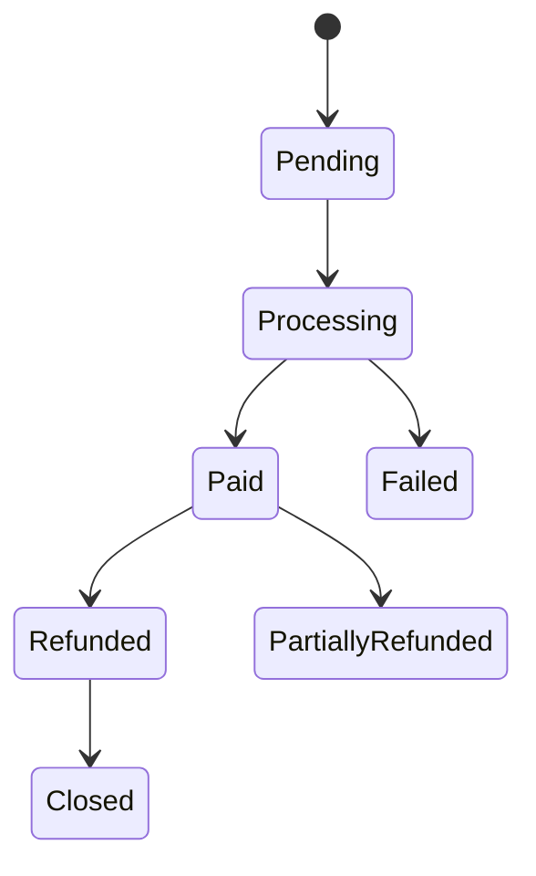

# 06_Screen_Specifications_07_Payment.md

# Restaurant POS Enterprise Product Bible
## Screen Specification – Payment & Settlement

**Screen ID:** SCR-PAY-001  
**Module:** Payments

---

# 1. Purpose

The Payment screen finalizes restaurant transactions by securely collecting payments, validating settlement, generating fiscal receipts, updating cashier shifts, triggering inventory completion, and closing orders.

---

# 2. Supported Payment Methods

- Cash
- Credit Card
- Debit Card
- UPI / QR
- Digital Wallet
- Gift Voucher
- Mixed Payment
- Complimentary (Manager Approval)

---

# 3. Business Goals

- Complete payment in under 20 seconds.
- Prevent duplicate payments.
- Support split tenders.
- Maintain a complete financial audit trail.

---

# 4. Screen Wireframe

```text
+--------------------------------------------------------------------------------+
| Bill #10245   Table:T12   Customer:Walk-in                                     |
+--------------------------------------------------------------------------------+
| Net Amount       : 1,250.00                                                    |
| Discount         :   100.00                                                    |
| Tax              :   135.00                                                    |
| Grand Total      : 1,285.00                                                    |
+--------------------------------------------------------------------------------+
| Payment Mode: [Cash][Card][UPI][Wallet][Mixed]                                 |
| Cash Received : __________                                                     |
| Card Amount   : __________  Ref No: __________                                 |
| UPI Amount    : __________  Txn ID: __________                                 |
| Change Return : __________                                                     |
+--------------------------------------------------------------------------------+
| [Collect Payment] [Split Payment] [Refund] [Print Receipt]                     |
+--------------------------------------------------------------------------------+
```

---

# 5. End-to-End Workflow



---

# 6. Business Logic

## Cash
- Calculate balance automatically.
- Update cash drawer.
- Record denomination if enabled.

## Card
- Capture terminal reference.
- Retry on timeout.
- Prevent duplicate authorization.

## UPI / Wallet
- Store transaction ID.
- Validate successful callback before completion.

## Mixed Payment
Rules:
- Sum of tenders = Bill Amount.
- Negative balance not allowed.
- Remaining amount displayed in real time.

## Complimentary Bills
Requires:
- Manager approval
- Reason
- Audit log

---

# 7. Refund Workflow



Rules:
- Original bill mandatory.
- Partial refunds supported.
- Inventory unaffected unless item cancellation policy applies.

---

# 8. Validation Rules

- Outstanding amount cannot be negative.
- Paid bill cannot be paid again.
- Refund <= original payment.
- Card reference mandatory for card payments.
- Mixed payment must equal total.
- Shift must be open.

---

# 9. Payment State Machine



---

# 10. API Contracts

POST /payments
POST /payments/split
POST /payments/refund
GET /payments/{id}
POST /payments/reprint
POST /cashdrawer/update

Example:

```json
{
  "orderId":10245,
  "paymentMode":"CARD",
  "amount":1285.00,
  "reference":"TXN998812"
}
```

---

# 11. Database Tables

- payments
- payment_transactions
- payment_modes
- payment_gateway_logs
- cashier_shift
- receipts
- refunds
- audit_logs

---

# 12. Domain Events

- PaymentInitiated
- PaymentSucceeded
- PaymentFailed
- ReceiptPrinted
- RefundApproved
- RefundCompleted
- CashDrawerUpdated

---

# 13. Security Rules

- JWT authentication.
- RBAC validation.
- PCI-sensitive data never stored.
- Receipt reprint logged.
- Refund approval mandatory above threshold.

---

# 14. Edge Cases

1. Double-click payment.
2. Network failure after authorization.
3. Gateway timeout.
4. Card approved but callback delayed.
5. Duplicate UPI callback.
6. Cash received less than bill.
7. Excess cash with change calculation.
8. Mixed payment mismatch.
9. Shift closes during payment.
10. Printer offline after payment.
11. Receipt reprint abuse.
12. Payment reversal.
13. Partial refund after split payment.
14. Offline payment sync conflict.
15. Currency rounding mismatch.
16. Complimentary after payment initiated.
17. Duplicate terminal reference.
18. Card machine disconnected.
19. Wallet provider unavailable.
20. Cash drawer offline.

---

# 15. Offline Behaviour

- Queue payment request.
- Prevent offline card authorization.
- Allow cash mode if configured.
- Reconcile queued transactions after reconnect.

---

# 16. Audit Trail

Capture:
- Order
- User
- Shift
- Payment mode
- Before/After status
- Refund reason
- Approval reference
- Device
- Timestamp

---

# 17. QA Scenarios

TC-001 Cash payment exact amount.
TC-002 Cash payment with change.
TC-003 Card payment success.
TC-004 Gateway timeout.
TC-005 Split payment.
TC-006 Partial refund.
TC-007 Duplicate payment prevention.
TC-008 Receipt reprint.

---

# 18. UAT Acceptance Criteria

- All payment modes complete successfully.
- Duplicate payment impossible.
- Receipt generated for every successful payment.
- Cash drawer balances with shift report.
- Refunds require configured approvals.
- Financial transactions fully auditable.

---

# Next Screen

06_Screen_Specifications_08_Kitchen_Display_System.md
