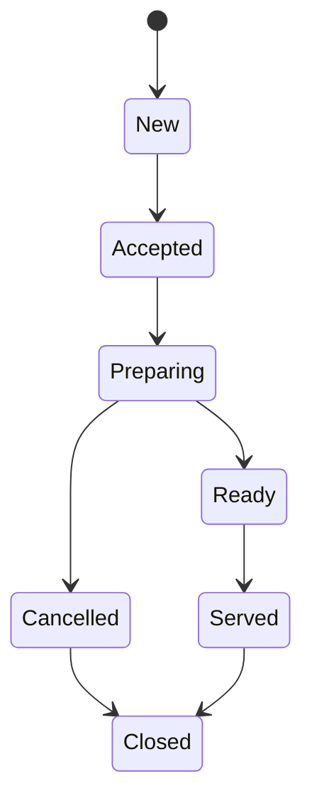
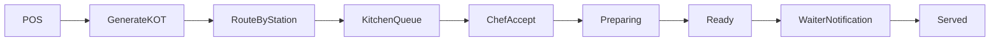

# 06_Screen_Specifications_08_Kitchen_Display_System.md

# Restaurant POS Enterprise Product Bible
## Screen Specification – Kitchen Display System (KDS)

**Screen ID:** SCR-KDS-001
**Module:** Kitchen Operations

---

# 1. Purpose

The Kitchen Display System (KDS) is the operational execution layer of the restaurant. It receives Kitchen Order Tickets (KOT), routes them to preparation stations, tracks preparation progress, manages kitchen workload, monitors SLA, and communicates food readiness back to the POS.

---

# 2. Actors

- Chef
- Kitchen Staff
- Beverage Counter
- Dessert Counter
- Kitchen Supervisor
- Restaurant Manager

---

# 3. Objectives

- Eliminate paper dependency (optional)
- Route items automatically
- Improve kitchen throughput
- Reduce preparation delays
- Monitor SLA in real time
- Prevent duplicate preparation

---

# 4. KOT Lifecycle



---

# 5. Kitchen Workflow



---

# 6. Screen Wireframe

```text
+--------------------------------------------------------------------------------+
| Kitchen : Main | Refresh | SLA Timer | Active Orders : 18                      |
+--------------------------------------------------------------------------------+
| NEW | PREPARING | READY | COMPLETED | CANCELLED                                |
+--------------------------------------------------------------------------------+
| KOT#101 | Table T12 | Waiter Rahul | 12:30 PM | ETA 08 min                     |
|--------------------------------------------------------------------------      |
| 2 x Veg Burger   [No Onion]                                                    |
| 1 x Fries                                                                  |
| 2 x Coke                                                                   |
| [Accept] [Prepare] [Ready] [Delay]                                         |
+--------------------------------------------------------------------------------+
```

---

# 7. Station Routing

| Item Category | Station |
|---|---|
| Grill | Grill Counter |
| Pizza | Pizza Oven |
| Beverage | Beverage Counter |
| Dessert | Dessert Counter |
| Tea/Coffee | Beverage Station |

Rules:
- One KOT may create multiple station tickets.
- Each station sees only relevant items.

---

# 8. Business Logic

### KOT Generation
- Only unsent items generate new KOT.
- Incremental KOT supported.
- Station determined by menu configuration.

### Acceptance
- First chef accepting acquires ownership.
- Ownership transferable by supervisor.

### Preparation
- Timer starts on Accept.
- Delay alert when SLA exceeded.

### Ready
- Notify waiter immediately.
- Update dashboard KPIs.

### Cancellation
- Requires manager approval after preparation starts.
- Cancel KOT printed/logged.

---

# 9. Validation Rules

- No Ready without Accepted.
- No Served without Ready.
- Cannot edit KOT items.
- Duplicate Ready blocked.
- Kitchen cannot delete KOT.

---

# 10. APIs

GET /kds/orders
GET /kds/station/{id}
POST /kds/accept
POST /kds/prepare
POST /kds/ready
POST /kds/cancel
GET /kds/history

---

# 11. Database Tables

- kot
- kot_items
- kitchen_station
- kitchen_queue
- menu_items
- order_items
- audit_logs
- notifications

---

# 12. WebSocket Events

- KOTCreated
- KOTAccepted
- PreparationStarted
- ItemReady
- KOTCancelled
- WaiterNotified

---

# 13. Notifications

- New KOT
- Ready for Pickup
- SLA Breach
- Station Offline
- Printer Failure
- Cancel Approval

---

# 14. SLA Rules

| Item Type | Target |
|---|---:|
| Tea/Coffee | 3 min |
| Beverage | 2 min |
| Starter | 8 min |
| Main Course | 15 min |
| Dessert | 5 min |

Alert at 80% SLA consumption.

---

# 15. Edge Cases

1. Duplicate KOT
2. Printer offline
3. KDS offline
4. Same KOT accepted by two chefs
5. Item cancelled during preparation
6. Station disabled
7. Kitchen reconnect after outage
8. Incremental KOT while previous active
9. Chef logout during preparation
10. SLA exceeded
11. Waiter not acknowledging ready order
12. Wrong station mapping
13. Menu item without kitchen section
14. Browser refresh during preparation
15. Kitchen display crash
16. Out-of-stock after KOT
17. Course sequencing conflict
18. Large party order prioritization
19. Manual reprint abuse
20. Delayed sync across terminals

---

# 16. Offline Behaviour

- Cache active queue.
- Sync status changes after reconnect.
- Prevent duplicate KOT using UUID.
- Preserve preparation timestamps.

---

# 17. Audit Trail

Track:
- KOT creation
- Station routing
- Accept
- Ready
- Cancellation
- SLA overrides
- Supervisor reassignment

---

# 18. QA Scenarios

TC-001 Generate new KOT.
TC-002 Route to correct station.
TC-003 Accept KOT.
TC-004 Mark Ready.
TC-005 Cancel after preparation.
TC-006 SLA breach notification.
TC-007 Incremental KOT.

---

# 19. UAT Acceptance Criteria

- Correct station receives correct items.
- Waiter notified within 1 second of Ready.
- Incremental KOT contains only new items.
- Kitchen queue updates in real time.
- All state transitions audited.

---

# Next Screen

06_Screen_Specifications_09_Purchase_Entry.md
