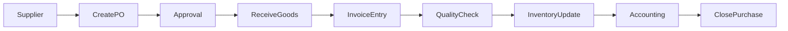
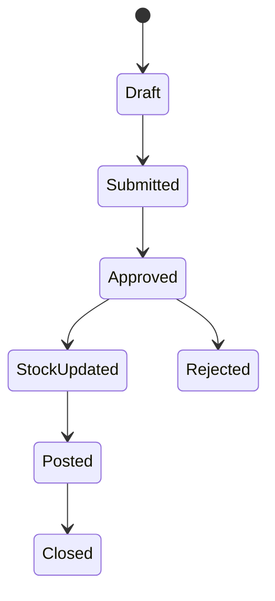

# 06_Screen_Specifications_09_Purchase_Entry.md

# Restaurant POS Enterprise Product Bible
## Screen Specification – Purchase Entry & Procurement

**Screen ID:** SCR-PUR-001
**Module:** Procurement & Purchasing

---

# 1. Purpose

The Purchase Entry screen manages the complete procurement lifecycle from supplier invoice capture through inventory update and financial posting. It ensures purchased goods are accurately recorded, validated, approved, and reflected in stock valuation.

---

# 2. Actors

- Stock Controller
- Purchase Executive
- Restaurant Manager
- Accountant
- Owner

---

# 3. Procurement Workflow



---

# 4. Screen Wireframe

```text
+--------------------------------------------------------------------------------+
| Supplier | Invoice No | Invoice Date | Warehouse | Branch                      |
+--------------------------------------------------------------------------------+
| Item | Qty | UOM | Unit Cost | Tax | Discount | Batch | Expiry                 |
+--------------------------------------------------------------------------------+
| Freight | Other Charges | Landed Cost | Net Total                             |
+--------------------------------------------------------------------------------+
| [Save Draft] [Submit] [Approve] [Print GRN] [Attach Invoice]                  |
+--------------------------------------------------------------------------------+
```

---

# 5. Business Logic

## Supplier
- Must be active.
- Branch-specific supplier rules supported.
- Credit limit warning displayed.

## Invoice
- Duplicate invoice check by Supplier + Invoice Number.
- Future dates blocked.
- Backdated entry requires approval.

## Line Items
- Quantity > 0.
- Unit Cost >= 0.
- Tax derived from item or supplier configuration.
- Batch & expiry mandatory for configurable products.

## Landed Cost

```
Landed Cost =
Purchase Cost
+ Freight
+ Handling
+ Import Duty
+ Other Charges

Weighted Average Cost =
((Existing Qty × Existing Avg Cost)
 + (Received Qty × Landed Cost))
 / Total Qty
```

## Inventory Update
- Stock ledger updated only after approval.
- Inventory valuation recalculated.
- Audit trail created.

---

# 6. Purchase State Machine



---

# 7. Validation Rules

- Supplier mandatory.
- At least one item required.
- Duplicate invoice blocked.
- Closed accounting period cannot accept entries.
- Negative quantity prohibited.
- Approval required above configurable threshold.

---

# 8. APIs

- GET /suppliers
- GET /inventory/items
- POST /purchases
- PATCH /purchases/{id}
- POST /purchases/{id}/approve
- POST /inventory/ledger
- GET /purchases/{id}

---

# 9. Database Tables

- suppliers
- purchase_orders
- purchases
- purchase_items
- inventory_ledger
- stock_batches
- warehouses
- taxes
- audit_logs

---

# 10. Events

- PurchaseCreated
- PurchaseSubmitted
- PurchaseApproved
- InventoryUpdated
- LedgerPosted

---

# 11. Approval Rules

| Condition | Approval |
|-----------|----------|
| Invoice > Configured Limit | Manager |
| Backdated Entry | Manager |
| Negative Margin Purchase | Owner |
| Supplier On Hold | Owner |

---

# 12. Edge Cases

1. Duplicate supplier invoice.
2. Invoice uploaded twice.
3. Partial goods receipt.
4. Excess quantity received.
5. Damaged goods.
6. Expired batch.
7. Wrong tax code.
8. Supplier deactivated during entry.
9. Network loss during save.
10. Approval after accounting close.
11. Currency mismatch.
12. Landed cost recalculation.
13. Duplicate barcode.
14. Batch merge conflict.
15. Inventory lock timeout.
16. Offline sync conflict.
17. Attachment upload failure.
18. Warehouse disabled.
19. Stock update retry.
20. Manual override without permission.

---

# 13. Offline Behaviour

- Save purchase draft locally.
- Queue approval requests.
- Sync inventory updates after reconnect.
- Detect duplicate invoices during synchronization.

---

# 14. Audit Trail

Record:
- Supplier selection
- Price changes
- Quantity changes
- Approval actions
- Stock posting
- User, device, IP, timestamp

---

# 15. QA Scenarios

- Create purchase.
- Duplicate invoice validation.
- Approval workflow.
- Inventory update.
- Landed cost calculation.
- Offline recovery.

---

# 16. UAT Acceptance Criteria

- Duplicate invoices prevented.
- Inventory reflects approved purchases only.
- Weighted average cost recalculated correctly.
- Complete audit trail maintained.
- Procurement cycle traceable end-to-end.

---

# Next Screen

06_Screen_Specifications_10_Inventory_Management.md
