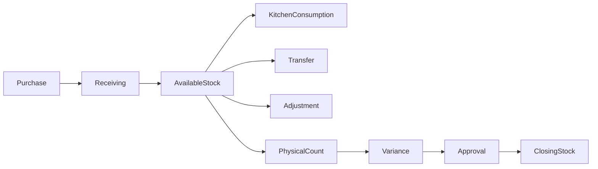
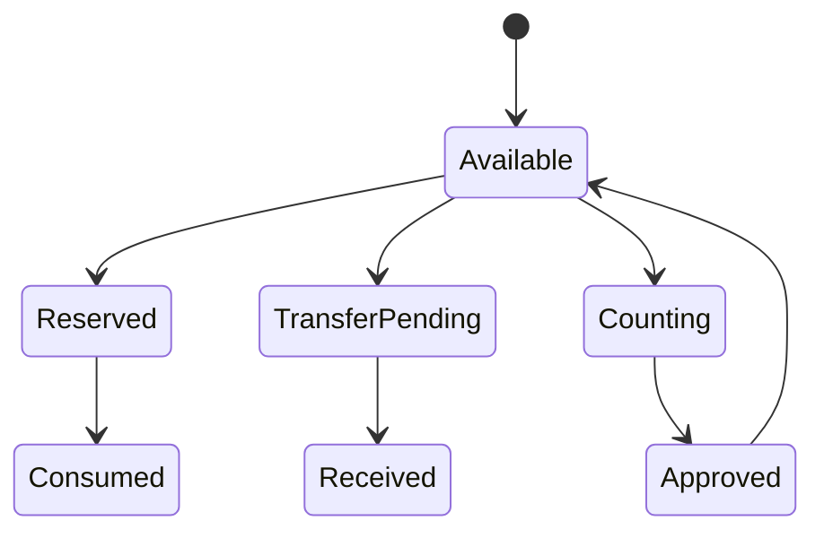

# 06_Screen_Specifications_10_Inventory_Management.md

# Restaurant POS Enterprise Product Bible
## Module Specification – Inventory Management

**Module ID:** MOD-INV-001

---

# 1. Purpose

The Inventory Management module maintains real-time stock accuracy across branches, warehouses, and kitchen consumption. It records every inventory movement, supports physical stock counts, manages batches and expiry, calculates inventory valuation, and provides complete traceability for audits.

---

# 2. Scope

Sub-modules:
- Inventory Dashboard
- Stock Ledger
- Stock In
- Stock Out
- Internal Consumption
- Purchase Receipt
- Stock Transfer
- Stock Adjustment
- Physical Stock Count
- Batch & Expiry
- Reorder Engine
- Valuation
- Inventory Reports

---

# 3. Inventory Lifecycle



---

# 4. Inventory Dashboard Wireframe

```text
+----------------------------------------------------------------------------------+
| Inventory Value | Low Stock | Out of Stock | Today's Consumption | Variance      |
+----------------------------------------------------------------------------------+
| Quick Actions: [Count] [Transfer] [Adjust] [Receive] [Ledger] [Reports]         |
+----------------------------------------------------------------------------------+
| Low Stock Items | Expiring Soon | Pending Transfers | Pending Counts            |
+----------------------------------------------------------------------------------+
```

---

# 5. Business Logic

## Stock Receipt
- Triggered from approved purchase.
- Increase available stock.
- Update weighted average cost.
- Create inventory ledger entry.

## Kitchen Consumption
- Deduct inventory based on recipe/BOM (future-ready).
- Manual deduction supported if BOM disabled.

## Stock Transfer
- Source warehouse validation.
- Destination warehouse validation.
- Stock reservation during transfer.
- Receipt confirmation required.

## Physical Count
- Freeze selected inventory.
- Enter counted quantity.
- Calculate variance.
- Approval required above tolerance.

## Stock Adjustment
Reasons:
- Damage
- Wastage
- Theft
- Expiry
- Manual Correction

Mandatory approval for configurable thresholds.

---

# 6. Inventory Formulae

Available Stock =
Opening
+ Purchases
+ Transfers In
- Transfers Out
- Sales Consumption
± Adjustments

Weighted Average Cost =
((Existing Qty × Existing Avg Cost) +
(New Qty × New Cost))
÷ Total Qty

Inventory Value =
Available Qty × Average Cost

Variance =
Physical Count - System Quantity

---

# 7. State Machine



---

# 8. Validation Rules

- Negative stock blocked unless configuration allows.
- Batch mandatory for tracked items.
- Expiry date cannot be in the past.
- Stock transfer cannot exceed available quantity.
- Physical count cannot overlap another active count.
- Closed accounting period locked.

---

# 9. APIs

GET /inventory/dashboard
GET /inventory/ledger
GET /inventory/items
POST /inventory/receipt
POST /inventory/transfer
POST /inventory/adjustment
POST /inventory/count
POST /inventory/count/approve
GET /inventory/reports
GET /inventory/valuation

---

# 10. Database Tables

- inventory_items
- inventory_ledger
- warehouses
- warehouse_bins
- stock_batches
- stock_transfers
- transfer_items
- stock_adjustments
- stock_counts
- stock_count_items
- inventory_valuation
- reorder_rules
- audit_logs

---

# 11. Events

- StockReceived
- StockTransferred
- StockAdjusted
- StockCountStarted
- StockCountApproved
- InventoryRecalculated
- LowStockTriggered

---

# 12. Notification Rules

- Low stock threshold reached
- Out of stock
- Expiring within X days
- Transfer awaiting receipt
- Count approval pending
- High variance detected

---

# 13. Edge Cases

1. Negative stock attempt.
2. Duplicate stock receipt.
3. Transfer destination disabled.
4. Batch mismatch.
5. Expired stock received.
6. Concurrent stock count.
7. Inventory adjustment after count.
8. Network failure during transfer.
9. Warehouse deleted.
10. Cost recalculation failure.
11. Duplicate barcode.
12. Wrong unit conversion.
13. Stock count timeout.
14. Approval after period close.
15. Offline adjustments.
16. Double receipt posting.
17. Inventory sync delay.
18. Consumption exceeds stock.
19. Manual override without reason.
20. High-value variance.

---

# 14. Offline Behaviour

- Queue inventory transactions.
- Preserve transaction UUID.
- Sync in chronological order.
- Conflict resolution using version numbers.

---

# 15. Audit Trail

Capture:
- Stock before/after
- Quantity delta
- Cost delta
- User
- Branch
- Warehouse
- Device
- Timestamp
- Approval reference

---

# 16. QA Scenarios

TC-001 Receive purchase.
TC-002 Transfer stock.
TC-003 Physical count.
TC-004 Variance approval.
TC-005 Negative stock validation.
TC-006 Expiry validation.
TC-007 Offline synchronization.

---

# 17. UAT Acceptance Criteria

- Inventory always matches approved transactions.
- Stock valuation recalculated correctly.
- Variances require approval.
- Complete movement history available.
- Real-time inventory visible across modules.

---

# Next Module

06_Screen_Specifications_11_Reporting_Analytics.md
