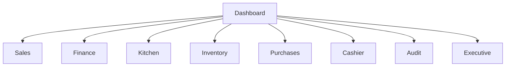
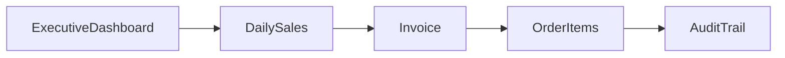

# 06_Screen_Specifications_11_Reporting_Analytics.md

# Restaurant POS Enterprise Product Bible
## Module Specification – Reporting & Analytics

**Module ID:** MOD-RPT-001

---

# 1. Purpose

The Reporting & Analytics module provides operational, financial, inventory, kitchen, cashier, and management insights. It consolidates transactional data into actionable dashboards and reports while supporting exports, scheduled delivery, and drill-down analysis.

---

# 2. Objectives

- Deliver near real-time operational visibility.
- Support business decision making.
- Enable audit and compliance.
- Provide configurable KPI dashboards.
- Export reports in multiple formats.

---

# 3. Report Hierarchy



---

# 4. Dashboard Wireframe

```text
+--------------------------------------------------------------------------------+
| Date Range | Branch | Shift | User | Export | Schedule | Refresh              |
+--------------------------------------------------------------------------------+
| Sales | Orders | GP | Avg Bill | Table Turnover | Inventory Value            |
+--------------------------------------------------------------------------------+
| Sales Trend | Hourly Orders | Payment Mix | Top Items | Low Stock              |
+--------------------------------------------------------------------------------+
| Report Grid                                                            Export  |
+--------------------------------------------------------------------------------+
```

---

# 5. Report Catalog

## Sales
- Daily Sales
- Monthly Sales
- Hourly Sales
- Category Sales
- Item Sales
- Waiter Performance

## Financial
- Payment Summary
- Tax Summary
- Discounts
- Refunds
- Complimentary Bills

## Kitchen
- KOT SLA
- Delayed Orders
- Preparation Time
- Station Performance

## Inventory
- Stock Ledger
- Valuation
- Variance
- Consumption
- Low Stock
- Expiry

## Procurement
- Purchases
- Supplier Performance
- Price Variance

## Audit
- Login History
- Overrides
- Refund Log
- Configuration Changes

---

# 6. KPI Definitions

| KPI | Formula |
|------|---------|
| Gross Sales | Sum(Order Total) |
| Net Sales | Gross - Discounts |
| Average Bill | Net Sales / Bills |
| Food Cost % | Consumption / Net Sales |
| Table Turnover | Closed Tables / Operating Hours |
| Refund % | Refund Amount / Net Sales |

---

# 7. Business Logic

- Reports filtered by RBAC.
- Default branch = logged-in branch.
- Archived data excluded from live dashboards.
- Cached reports refreshed every 5 minutes.
- Large reports processed asynchronously.

---

# 8. Drill-down Flow



---

# 9. Validation Rules

- Date range mandatory.
- End date >= Start date.
- Export size limits configurable.
- Users access only authorized branches.
- Scheduled reports require email configuration.

---

# 10. APIs

GET /reports/dashboard
GET /reports/sales
GET /reports/payments
GET /reports/inventory
GET /reports/kitchen
GET /reports/purchases
GET /reports/audit
POST /reports/export
POST /reports/schedule

---

# 11. Database Tables

- report_definitions
- report_jobs
- dashboard_widgets
- orders
- payments
- inventory_ledger
- purchases
- audit_logs
- scheduled_reports

---

# 12. Events

- ReportGenerated
- ExportCompleted
- ScheduleCreated
- DashboardViewed

---

# 13. Export Formats

- PDF
- Excel
- CSV

Rules:
- Watermark confidential reports.
- Log every export.

---

# 14. Edge Cases

1. Empty report.
2. Invalid date range.
3. Large dataset timeout.
4. Export failure.
5. Missing permissions.
6. Branch deleted.
7. Scheduled email failure.
8. Cache inconsistency.
9. Offline dashboard.
10. Concurrent report execution.
11. Data refresh delay.
12. Widget configuration missing.
13. Timezone mismatch.
14. Fiscal period closed.
15. Report definition modified during execution.
16. Duplicate schedules.
17. Printer unavailable.
18. Corrupt export.
19. Database failover.
20. Partial aggregation failure.

---

# 15. Audit Trail

Capture:
- Report viewed
- Filters applied
- Export action
- Schedule changes
- User, Branch, Device, Timestamp

---

# 16. QA Scenarios

TC-001 Daily sales report.
TC-002 Export Excel.
TC-003 RBAC validation.
TC-004 Scheduled report.
TC-005 Drill-down navigation.
TC-006 Empty report.

---

# 17. UAT Acceptance Criteria

- KPIs match transactional data.
- Reports export successfully.
- Drill-down works without data loss.
- Unauthorized reports hidden.
- Scheduled reports delivered successfully.

---

# Next Module

06_Screen_Specifications_12_Administration_Settings.md
