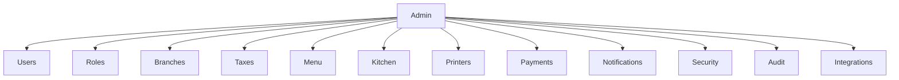

# 06_Screen_Specifications_12_Administration_Settings.md

# Restaurant POS Enterprise Product Bible
## Module Specification – Administration & System Settings

**Module ID:** MOD-ADM-001

---

# 1. Purpose

The Administration module is the central configuration hub for the Restaurant POS platform. It governs users, roles, permissions, branches, taxes, printers, kitchen stations, menus, payment modes, integrations, feature flags, security, and audit policies.

---

# 2. Actors

- System Administrator
- Owner
- Restaurant Manager (limited)
- Accountant (limited)

---

# 3. Administration Architecture



---

# 4. Screen Layout

```text
+--------------------------------------------------------------------------------+
| Search | Branch | Environment | Save | Publish | Rollback                      |
+--------------------------------------------------------------------------------+
| Left Menu                                                                    |
| Users                                                                         |
| Roles                                                                         |
| Branches                                                                      |
| Menu Masters                                                                  |
| Taxes                                                                         |
| Printers                                                                      |
| Kitchen Stations                                                              |
| Payment Modes                                                                 |
| Notifications                                                                 |
| Integrations                                                                  |
| Security                                                                       |
+--------------------------------------------------------------------------------+
| Configuration Workspace                                                      |
+--------------------------------------------------------------------------------+
```

---

# 5. Functional Areas

## User Management
- Create/Edit/Deactivate users
- Password reset
- Device assignment
- Branch assignment

## RBAC
- Roles
- Permissions
- Screen access
- API access
- Approval levels

## Branches
- Branch master
- Warehouse mapping
- Operating hours
- Currency
- Timezone

## Menu Masters
- Categories
- Menu Items
- Modifiers
- Combo Meals
- Pricing

## Kitchen
- Station mapping
- Printer mapping
- SLA defaults

## Taxes
- GST/VAT profiles
- Inclusive/Exclusive tax
- Service charge

## Payments
- Payment modes
- Gateway credentials
- Refund policy
- Tip policy

## Notifications
- Email
- SMS
- WhatsApp
- Push
- Webhooks

## Security
- Password policy
- MFA (future)
- Session timeout
- IP restrictions

---

# 6. Business Rules

- No user without role.
- Every role requires at least one permission.
- Branch deletion blocked if transactions exist.
- Menu deletion blocked when referenced by active orders.
- Tax changes are versioned.
- Feature flags require publish.

---

# 7. Approval Matrix

| Action | Approval |
|---|---|
| Delete User | Owner |
| Change Tax | Owner |
| Change Payment Gateway | Owner |
| Disable Branch | Owner |
| Publish Feature Flag | Admin |

---

# 8. Validation Rules

- Username unique.
- Branch code unique.
- Tax percentage between configured limits.
- Printer mapped to active branch.
- Menu item requires category.
- Payment mode unique.

---

# 9. APIs

GET /admin/users
POST /admin/users
PATCH /admin/users/{id}
GET /admin/roles
POST /admin/roles
GET /admin/branches
POST /admin/taxes
POST /admin/printers
POST /admin/kitchen-stations
POST /admin/payment-modes
POST /admin/settings

---

# 10. Database Tables

- users
- user_sessions
- roles
- permissions
- role_permissions
- branches
- settings
- tax_profiles
- printers
- kitchen_stations
- payment_modes
- feature_flags
- integrations
- audit_logs

---

# 11. Events

- UserCreated
- RoleUpdated
- BranchPublished
- TaxChanged
- FeatureEnabled
- PrinterMapped

---

# 12. Edge Cases

1. Duplicate username.
2. Duplicate branch code.
3. Permission removed during session.
4. Printer mapped twice.
5. Tax changed mid-shift.
6. Role deleted with active users.
7. Feature flag rollback.
8. Invalid webhook URL.
9. Payment gateway credentials expired.
10. Branch disabled while active shift exists.
11. Session timeout during save.
12. Concurrent settings update.
13. Unauthorized API access.
14. Password policy conflict.
15. Integration failure.
16. Audit storage unavailable.
17. Publish failure.
18. Rollback after deployment.
19. Inactive menu category referenced.
20. Notification provider outage.

---

# 13. Audit Trail

Log:
- Before/After values
- User
- Branch
- Device
- Timestamp
- Reason
- Approval reference

---

# 14. QA Scenarios

- Create user
- Reset password
- Configure printer
- Modify tax
- Assign permissions
- Publish feature flag

---

# 15. UAT Acceptance Criteria

- RBAC enforced across all modules.
- Configuration changes versioned.
- Critical changes require approval.
- Audit logs immutable.
- Rollback restores previous configuration.

---

# Next Major Section

**07_Database_Design/**

This section will define the complete enterprise data model including:
- 70–100 normalized tables
- Full ERD
- Keys, indexes, constraints
- Naming standards
- Partitioning strategy
- Archival strategy
- Data retention
