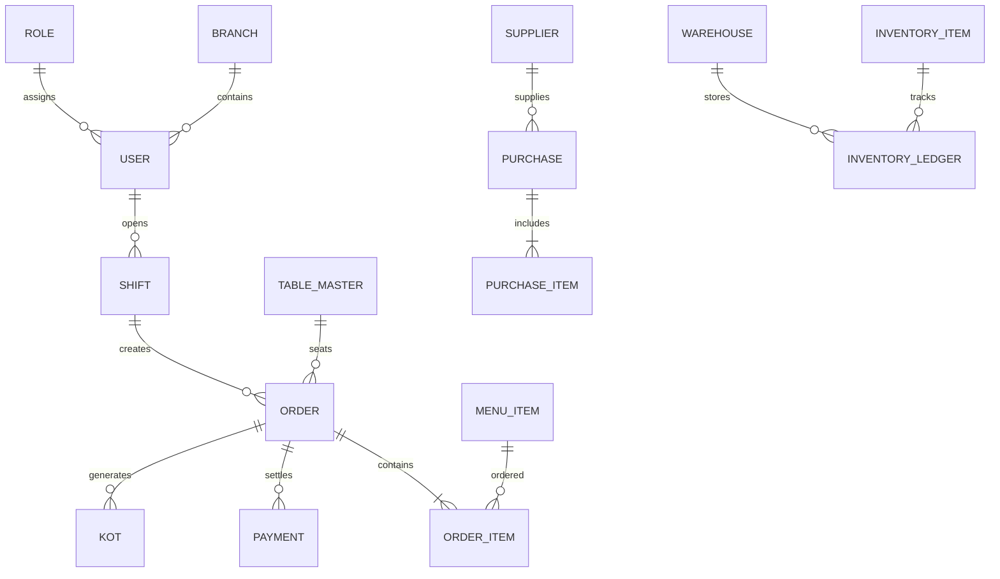

# 07_Database_Design_01_ERD_and_Data_Model.md

# Restaurant POS Enterprise Product Bible
## Enterprise Database Design (Part 1)

**Module ID:** DB-001

---

# 1. Purpose

This document defines the foundational relational data model for the Restaurant POS platform. It establishes entity ownership, relationships, normalization rules, primary keys, foreign keys, indexing strategy, and data lifecycle.

> This is Part 1 of the database design. Subsequent files will expand every table with column-level definitions.

---

# 2. Design Principles

- PostgreSQL 16+
- Third Normal Form (3NF)
- UUID primary keys for distributed deployments
- Soft delete for business entities
- Immutable financial records
- Audit trail for all mutations
- Multi-tenant ready (Branch-aware)

---

# 3. Domain Model

---

# 4. Database Domains

## Security
- users
- roles
- permissions
- role_permissions
- user_sessions
- devices

## Restaurant Operations
- branches
- floors
- tables
- reservations
- shifts

## POS
- orders
- order_items
- modifiers
- kot
- receipts
- payments
- refunds

## Inventory
- inventory_items
- warehouses
- warehouse_bins
- inventory_ledger
- stock_batches
- stock_adjustments
- stock_counts
- stock_count_items

## Procurement
- suppliers
- purchase_orders
- purchases
- purchase_items

## Administration
- settings
- feature_flags
- printers
- kitchen_stations
- tax_profiles

## Analytics
- report_jobs
- dashboard_widgets

## Audit
- audit_logs
- event_logs

---

# 5. Naming Standards

- Tables: snake_case plural
- Columns: snake_case
- Primary Key: id (UUID)
- Foreign Keys: <entity>_id
- Audit Columns:
  - created_at
  - updated_at
  - deleted_at
  - created_by
  - updated_by

---

# 6. Key Relationships

| Parent | Child | Cardinality |
|---------|-------|-------------|
| Branch | Users | 1:N |
| Branch | Tables | 1:N |
| Order | Order Items | 1:N |
| Order | Payments | 1:N |
| Purchase | Purchase Items | 1:N |
| Warehouse | Inventory Ledger | 1:N |

---

# 7. Indexing Strategy

Mandatory indexes:
- users(username)
- orders(order_number)
- payments(transaction_reference)
- inventory_ledger(item_id, warehouse_id)
- purchases(invoice_number, supplier_id)
- audit_logs(created_at)

Composite indexes:
- (branch_id, created_at)
- (status, created_at)
- (warehouse_id, item_id)

---

# 8. Partitioning

Recommended:
- audit_logs by month
- inventory_ledger by month
- order_items by year
- event_logs by month

---

# 9. Archival Strategy

Hot Data:
- Current financial year

Warm Data:
- Previous 5 years

Cold Archive:
- >5 years
- Read-only

---

# 10. Referential Integrity Rules

- Orders cannot exist without Branch.
- Payments require Order.
- Purchase Items require Purchase.
- Ledger entries immutable after posting.
- Delete restricted when transactional references exist.

---

# 11. Performance Targets

- Order lookup <100 ms
- Payment lookup <100 ms
- Inventory query <300 ms
- Dashboard aggregation <2 sec

---

# 12. Next Files

02_User_Security_Tables.md
03_POS_Tables.md
04_Inventory_Tables.md
05_Purchase_Tables.md
06_Admin_Tables.md
07_Audit_Tables.md

