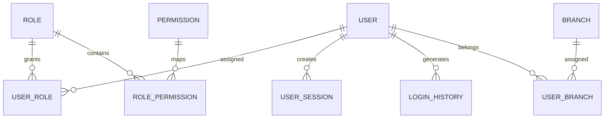

# 07_Database_Design_02_User_Security_Tables.md

# Restaurant POS Enterprise Product Bible
## Database Design – User & Security Domain

**Module ID:** DB-SEC-002

---

# 1. Purpose

This document defines the authentication, authorization, user management, session management and security data model.

---

# 2. Tables Covered

1. users
2. user_profiles
3. roles
4. permissions
5. role_permissions
6. user_roles
7. branches
8. user_branches
9. devices
10. user_sessions
11. login_history
12. password_history
13. api_keys
14. oauth_clients
15. feature_flags
16. security_policies

---

# 3. ER Diagram

---

# 4. Table: users

## Purpose
Stores master identity for every system user.

### Columns

| Column | Type | Null | Description |
|---|---|---|---|
| id | UUID | No | Primary Key |
| employee_code | VARCHAR(30) | No | Unique employee code |
| username | VARCHAR(100) | No | Login name |
| email | VARCHAR(255) | Yes | Email |
| phone | VARCHAR(20) | Yes | Mobile |
| password_hash | TEXT | No | Encrypted password |
| status | ENUM | No | Active/Inactive/Locked |
| default_branch_id | UUID | Yes | FK Branch |
| created_at | TIMESTAMP | No | Audit |
| updated_at | TIMESTAMP | No | Audit |

Indexes
- username UNIQUE
- employee_code UNIQUE
- email
- status

Business Rules
- Username immutable after first login (configurable).
- Password stored only as salted hash.
- Locked users cannot authenticate.

---

# 5. Table: roles

Columns
- id
- role_code
- role_name
- description
- is_system_role

Default Roles
- Owner
- Manager
- Cashier
- Waiter
- Kitchen
- Inventory
- Accountant
- Admin

---

# 6. Table: permissions

Permission Format

MODULE.ACTION

Examples

POS.CREATE

POS.REFUND

PAYMENT.VOID

INVENTORY.ADJUST

REPORT.EXPORT

ADMIN.USER.CREATE

---

# 7. role_permissions

Purpose

Many-to-many mapping.

Unique Constraint

(role_id, permission_id)

---

# 8. user_sessions

Stores

- JWT ID
- Login Time
- Logout Time
- Device
- IP Address
- Browser
- Last Activity

Rules

Idle timeout configurable.

Single or multiple concurrent sessions configurable.

---

# 9. login_history

Tracks

- Success
- Failure
- Locked
- MFA (future)
- Password reset

Retention

365 days online.

---

# 10. Security Policies

Password

Minimum Length

Uppercase

Lowercase

Numeric

Special Character

Password Expiry

Password Reuse

Account Lock

Session Timeout

IP Restrictions

Device Trust

---

# 11. Sample Permission Matrix

| Role | Create Order | Refund | Inventory | Users |
|---|---|---|---|---|
| Cashier | ✔ | ✖ | ✖ | ✖ |
| Manager | ✔ | ✔ | ✔ | ✖ |
| Owner | ✔ | ✔ | ✔ | ✔ |

---

# 12. APIs

GET /users
POST /users
PATCH /users/{id}
DELETE /users/{id}
GET /roles
POST /roles
GET /permissions
POST /login
POST /logout

---

# 13. Audit Rules

Every security action logs:

- User
- Device
- IP
- Timestamp
- Before Value
- After Value
- Reason

---

# 14. QA

- Duplicate username
- Locked account
- Expired password
- Concurrent login
- Branch restriction
- Role removal

---

# 15. Next

07_Database_Design_03_POS_Tables.md
