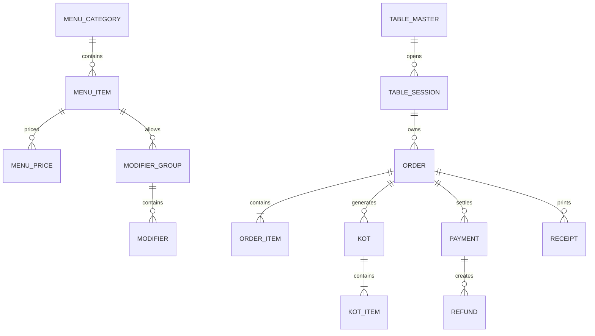

# 07_Database_Design_03_POS_Tables.md

# Restaurant POS Enterprise Product Bible
## Database Design – POS Transaction Domain

**Module:** DB-POS-003

---

# Purpose

Defines the transactional schema supporting restaurant operations from menu management through order completion and payment.

## Domain ERD

---

# Tables

## menu_categories
Purpose: Organize menu hierarchy.

Columns:
- id UUID PK
- parent_category_id UUID FK
- code VARCHAR(30) UNIQUE
- name VARCHAR(150)
- display_order INT
- kitchen_station_id UUID
- is_active BOOLEAN
- created_at TIMESTAMP
- updated_at TIMESTAMP

Rules
- Parent optional.
- Display order unique within parent.

Indexes
- code
- parent_category_id

---

## menu_items

Columns
- id UUID PK
- category_id FK
- sku
- name
- description
- base_price DECIMAL
- tax_profile_id FK
- kitchen_station_id FK
- preparation_time_minutes
- is_veg
- is_active

Business Rules
- Cannot deactivate if present in active order.
- Price maintained in price table for history.

---

## menu_prices

Supports:
- Branch pricing
- Happy hour
- Date effective pricing

Columns:
- menu_item_id
- branch_id
- effective_from
- effective_to
- selling_price

Unique:
(menu_item_id, branch_id, effective_from)

---

## modifiers

Examples
- Extra Cheese
- No Onion
- Extra Spicy

Columns:
id
modifier_group_id
name
price_delta
is_default
is_active

---

## table_master

Columns
- id
- floor_id
- code
- capacity
- status
- qr_code
- is_active

Status
Available
Reserved
Occupied
Billing
Cleaning

---

## table_sessions

Tracks each seating.

Columns
- id
- table_id
- opened_by
- guest_count
- opened_at
- closed_at

---

## orders

Columns
- id UUID
- order_number BIGINT UNIQUE
- table_session_id
- branch_id
- shift_id
- order_type
- status
- subtotal
- discount
- tax
- service_charge
- grand_total
- created_by
- created_at

State
Draft→Confirmed→KOT→Preparing→Ready→Paid→Closed

Indexes
(order_number)
(branch_id,status)
(created_at)

---

## order_items

Columns
- id
- order_id
- menu_item_id
- seat_no
- quantity
- unit_price
- modifier_total
- tax_amount
- status

Rules
- Immutable after payment.
- Versioned after KOT.

---

## kot

Columns
- id
- order_id
- kot_number
- station_id
- status
- generated_at

Rules
- Incremental KOT supported.
- Only unsent items included.

---

## kot_items

Columns
- kot_id
- order_item_id
- quantity
- remarks
- status

---

## payments

Columns
- id
- order_id
- payment_mode
- amount
- gateway_reference
- status
- paid_at

Unique
gateway_reference

---

## receipts

Columns
- id
- receipt_number
- order_id
- payment_id
- printed_at
- reprint_count

---

## refunds

Columns
- id
- payment_id
- amount
- reason
- approved_by
- refunded_at

---

# Cross-table Rules

1. One active order per table session.
2. Paid orders cannot be edited.
3. Receipt generated only after successful payment.
4. KOT created only for confirmed items.
5. Refund <= payment amount.
6. Menu item deletion prohibited when referenced.

---

# CRUD Ownership

| Table | Owner Service |
|---|---|
| orders | POS |
| order_items | POS |
| kot | Kitchen |
| payments | Payment |
| receipts | Payment |

---

# APIs

GET /menu
GET /tables
POST /orders
PATCH /orders/{id}
POST /orders/{id}/items
POST /kot
POST /payments
POST /refunds

---

# QA Focus

- Concurrent order updates
- Duplicate KOT prevention
- Payment locking
- Receipt numbering
- Modifier pricing
- Branch pricing

---

# Next

07_Database_Design_04_Inventory_Tables.md
