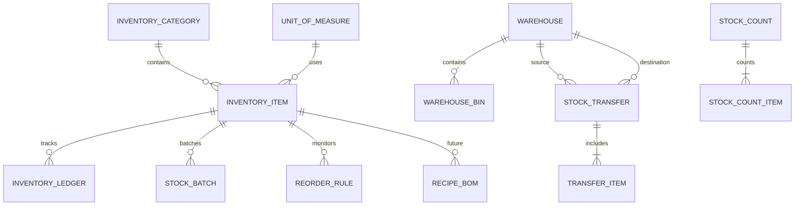

# 07_Database_Design_04_Inventory_Tables.md

# Restaurant POS Enterprise Product Bible
## Database Design – Inventory Domain

**Module ID:** DB-INV-004

---

# 1. Purpose

This document defines the complete inventory data model supporting purchasing, stock management, warehouse operations, physical counts, valuation, batch tracking, and kitchen consumption.

---

# 2. Domain ERD

---

# 3. Tables Covered

1. inventory_categories
2. unit_of_measure
3. inventory_items
4. warehouses
5. warehouse_bins
6. inventory_ledger
7. stock_batches
8. stock_transfers
9. transfer_items
10. stock_adjustments
11. stock_count
12. stock_count_items
13. inventory_valuation
14. reorder_rules
15. recipe_bom (future-ready)
16. consumption_history

---

# 4. inventory_categories

Purpose:
Hierarchical categorization of raw materials.

Columns:
- id UUID PK
- parent_category_id UUID FK
- code VARCHAR(30) UNIQUE
- name VARCHAR(150)
- description TEXT
- is_active BOOLEAN
- created_at TIMESTAMP
- updated_at TIMESTAMP

Business Rules
- Parent optional.
- Category cannot be deleted if linked items exist.

Indexes
- code
- parent_category_id

---

# 5. unit_of_measure

Examples:
- KG
- Gram
- Litre
- ml
- Piece
- Box
- Packet

Columns:
- id
- code
- name
- conversion_factor
- base_unit

Rules
- Conversion factor > 0.
- Base unit immutable.

---

# 6. inventory_items

Columns:
- id UUID
- sku
- barcode
- category_id
- default_uom_id
- name
- reorder_level
- reorder_quantity
- track_batch
- track_expiry
- valuation_method
- is_active

Business Rules
- SKU unique.
- Barcode unique (optional).
- Valuation method fixed after first transaction.

---

# 7. warehouses

Columns:
- id
- branch_id
- code
- name
- address
- is_default
- is_active

Rules
- One default warehouse per branch.

---

# 8. warehouse_bins

Purpose:
Physical storage locations.

Columns:
- id
- warehouse_id
- code
- description
- capacity

---

# 9. inventory_ledger

Purpose:
Immutable transaction ledger.

Columns:
- id
- item_id
- warehouse_id
- transaction_type
- reference_type
- reference_id
- quantity_in
- quantity_out
- running_balance
- average_cost
- transaction_date

Rules
- Append only.
- No updates after posting.

Indexes
- (item_id, warehouse_id)
- transaction_date

---

# 10. stock_batches

Columns:
- id
- item_id
- batch_number
- manufacture_date
- expiry_date
- quantity
- remaining_quantity

Business Rules
- Remaining quantity >=0.
- Expired batches blocked from issue (configurable).

---

# 11. stock_transfers

Columns:
- id
- source_warehouse_id
- destination_warehouse_id
- status
- requested_by
- approved_by
- shipped_at
- received_at

States:
Draft -> Approved -> Shipped -> Received -> Closed

---

# 12. transfer_items

Columns:
- transfer_id
- item_id
- requested_qty
- shipped_qty
- received_qty

Rules
- Received <= Shipped.

---

# 13. stock_adjustments

Reasons:
- Damage
- Theft
- Expiry
- Wastage
- Manual Correction

Columns:
- id
- item_id
- adjustment_type
- quantity
- reason
- approved_by

---

# 14. stock_count

Columns:
- id
- warehouse_id
- status
- started_by
- approved_by
- started_at
- completed_at

States:
Open -> Counting -> Submitted -> Approved -> Closed

---

# 15. stock_count_items

Columns:
- stock_count_id
- item_id
- system_qty
- physical_qty
- variance

Formula:
Variance = Physical - System

---

# 16. inventory_valuation

Stores:
- item_id
- warehouse_id
- qty
- avg_cost
- total_value
- valuation_date

---

# 17. reorder_rules

Columns:
- item_id
- minimum_level
- reorder_qty
- preferred_supplier
- auto_generate_po

---

# 18. recipe_bom (Future)

Purpose:
Link finished menu items to raw inventory.

Example:
Burger
- Bun
- Patty
- Cheese
- Lettuce

---

# 19. consumption_history

Tracks:
- menu_item
- inventory_item
- consumed_qty
- order_id
- timestamp

---

# 20. Cross-table Business Rules

1. Ledger is immutable.
2. Batch depletion follows FEFO if enabled.
3. Warehouse transfer requires source availability.
4. Stock count freezes inventory.
5. Reorder triggered when available <= minimum.
6. Consumption generated from completed orders.

---

# 21. APIs

GET /inventory/items
GET /inventory/ledger
POST /inventory/receipt
POST /inventory/transfer
POST /inventory/adjustment
POST /inventory/count
GET /inventory/valuation

---

# 22. QA Focus

- Batch tracking
- Expiry validation
- Concurrent stock count
- FEFO allocation
- Ledger immutability
- Warehouse transfers
- Reorder generation

---

# 23. Next

07_Database_Design_05_Purchase_Tables.md
