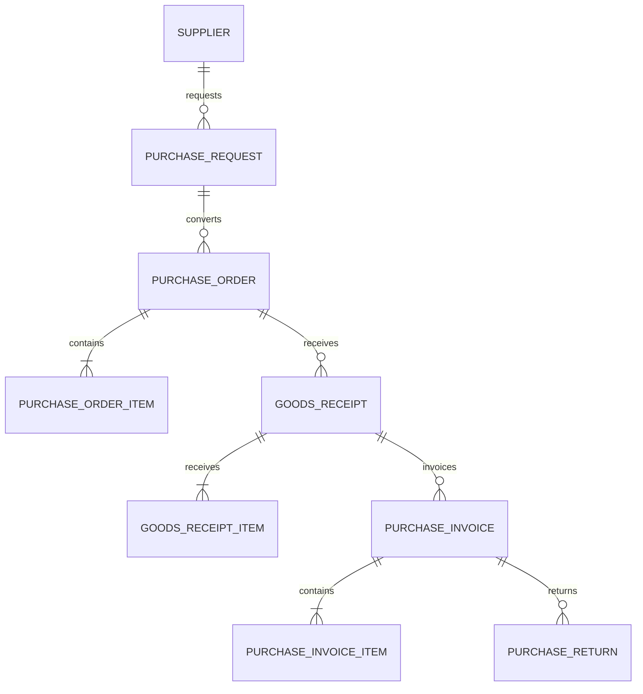

# 07_Database_Design_05_Purchase_Tables.md

# Restaurant POS Enterprise Product Bible
## Database Design – Procurement Domain

**Module ID:** DB-PUR-005

---

# 1. Purpose

Defines the enterprise procurement data model covering supplier onboarding, purchase requests, purchase orders, goods receipt, invoices, landed costs, approvals, returns, and financial posting.

---

# 2. Domain ER Diagram

---

# 3. Tables

1. suppliers
2. supplier_contacts
3. purchase_requests
4. purchase_request_items
5. purchase_orders
6. purchase_order_items
7. goods_receipts
8. goods_receipt_items
9. purchase_invoices
10. purchase_invoice_items
11. landed_costs
12. supplier_payments
13. purchase_returns
14. purchase_return_items
15. supplier_price_history
16. supplier_documents

---

# 4. suppliers

Purpose: Supplier master.

Columns:
- id UUID PK
- supplier_code UNIQUE
- supplier_name
- gst_number
- pan_number
- payment_terms
- credit_limit
- status
- preferred_supplier
- created_at
- updated_at

Rules
- GST unique where applicable.
- Inactive suppliers cannot receive new POs.

---

# 5. purchase_orders

Columns
- id
- po_number UNIQUE
- supplier_id
- warehouse_id
- currency
- expected_delivery_date
- subtotal
- tax_total
- grand_total
- status
- approved_by

States

Draft → Submitted → Approved → Partially Received → Received → Closed → Cancelled

Indexes
- po_number
- supplier_id,status

---

# 6. purchase_order_items

Columns
- purchase_order_id
- inventory_item_id
- ordered_qty
- received_qty
- unit_price
- tax_amount
- line_total

Rule:
received_qty <= ordered_qty (unless over-receipt enabled)

---

# 7. goods_receipts

Purpose:
Record physical receipt before invoice.

Columns
- id
- grn_number
- purchase_order_id
- warehouse_id
- received_by
- received_at
- status

---

# 8. purchase_invoices

Columns
- invoice_number
- supplier_id
- invoice_date
- due_date
- currency
- subtotal
- tax_total
- grand_total
- posting_status

Validation
- Duplicate invoice blocked by supplier + invoice_number.

---

# 9. landed_costs

Cost Types
- Freight
- Insurance
- Customs
- Local Transport
- Handling

Allocation
- By Value
- By Quantity
- By Weight
- Equal Distribution

---

# 10. purchase_returns

Reasons
- Damaged
- Wrong Item
- Expired
- Excess Supply

States
Draft → Approved → Returned → Credit Note Received → Closed

---

# 11. supplier_price_history

Tracks
- Supplier
- Item
- Old Price
- New Price
- Effective Date

Used for variance reporting.

---

# 12. Cross-table Business Rules

1. PO approval required before GRN.
2. GRN updates inventory.
3. Invoice cannot exceed configurable tolerance.
4. Returns reverse inventory.
5. Supplier payment only for approved invoices.
6. Closed PO immutable.

---

# 13. APIs

GET /suppliers
POST /purchase-orders
POST /goods-receipts
POST /purchase-invoices
POST /purchase-returns
GET /supplier-price-history

---

# 14. Index Strategy

- supplier_code
- po_number
- invoice_number
- grn_number
- (supplier_id, invoice_date)
- (status, expected_delivery_date)

---

# 15. QA Focus

- Duplicate invoices
- Partial receipt
- Over receipt
- Landed cost allocation
- Return processing
- Credit note reconciliation
- Supplier price changes

---

# 16. Next

07_Database_Design_06_Admin_Tables.md
