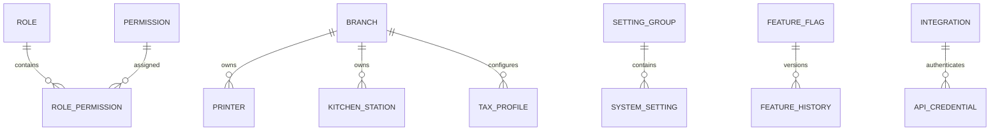

# 07_Database_Design_06_Admin_Tables.md

# Restaurant POS Enterprise Product Bible
## Database Design – Administration & Configuration Domain

**Module ID:** DB-ADM-006

---

# 1. Purpose

Defines the master data and configuration schema supporting system administration, RBAC, feature configuration, integrations, notifications, printers, taxes, payment modes, and configuration versioning.

---

# 2. Domain ER Diagram

---

# 3. Tables Covered

1. setting_groups
2. system_settings
3. branches
4. business_profiles
5. tax_profiles
6. payment_modes
7. printers
8. printer_mappings
9. kitchen_stations
10. notification_templates
11. notification_channels
12. integrations
13. api_credentials
14. feature_flags
15. feature_history
16. configuration_versions

---

# 4. system_settings

Purpose:
Stores configurable application parameters.

Columns:
- id UUID
- setting_group_id
- setting_key
- setting_value
- data_type
- is_encrypted
- branch_id
- updated_by
- updated_at

Rules
- Keys unique within branch.
- Encrypted values never exposed.

---

# 5. branches

Columns
- id
- branch_code
- branch_name
- timezone
- currency
- address
- gst_number
- status

Rules
- Branch code unique.
- Branch cannot deactivate with open shifts.

---

# 6. tax_profiles

Columns
- id
- tax_code
- tax_name
- tax_percentage
- tax_type
- effective_from
- effective_to

Rules
- Effective periods cannot overlap.

---

# 7. payment_modes

Examples
- Cash
- Card
- UPI
- Wallet
- Gift Card

Columns
- id
- code
- display_name
- gateway_name
- requires_reference
- is_active

---

# 8. printers

Columns
- id
- branch_id
- printer_name
- printer_type
- ip_address
- port
- status

Mappings
- Receipt
- Kitchen
- Bar
- Dessert

---

# 9. kitchen_stations

Columns
- id
- station_code
- station_name
- printer_id
- sla_minutes
- display_order

---

# 10. notification_templates

Supported Channels
- Email
- SMS
- WhatsApp
- Push
- Webhook

Columns
- template_code
- subject
- body
- language
- is_active

---

# 11. integrations

Purpose:
External systems.

Examples
- Payment Gateway
- Accounting ERP
- SMS Provider
- WhatsApp API

Columns
- id
- integration_name
- provider
- status
- retry_policy

---

# 12. api_credentials

Columns
- integration_id
- client_id
- encrypted_secret
- token_expiry
- last_rotated_at

Business Rules
- Secrets encrypted.
- Rotation tracked.

---

# 13. feature_flags

Columns
- feature_key
- enabled
- rollout_percentage
- environment
- effective_date

Supports:
- Gradual rollout
- Branch rollout
- A/B testing

---

# 14. configuration_versions

Stores:
- version_number
- changed_by
- published_at
- rollback_reference

---

# 15. Cross-table Business Rules

1. Tax profiles versioned.
2. Feature flag publish creates history.
3. Printer mapping required before POS activation.
4. Payment mode inactive => hidden from POS.
5. Notification template required before channel activation.
6. Configuration rollback restores previous values.

---

# 16. APIs

GET /admin/settings
POST /admin/settings
POST /admin/taxes
POST /admin/payment-modes
POST /admin/printers
POST /admin/feature-flags
POST /admin/integrations

---

# 17. Indexing

- setting_key
- branch_code
- tax_code
- feature_key
- integration_name

---

# 18. QA Focus

- Feature rollout
- Tax versioning
- Printer reassignment
- Configuration rollback
- Secret encryption
- Branch isolation

---

# 19. Next

07_Database_Design_07_Audit_Tables.md
