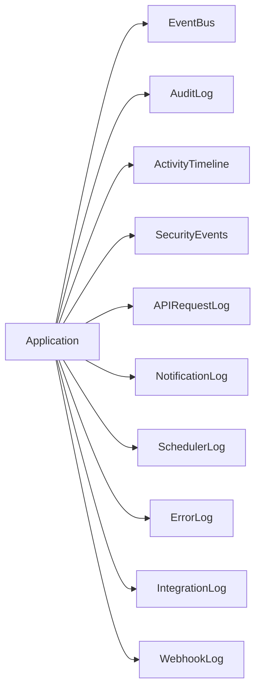

# 07_Database_Design_07_Audit_Tables.md

# Restaurant POS Enterprise Product Bible
## Database Design – Audit, Logging & Observability

**Module ID:** DB-AUD-007

---

# 1. Purpose

This document defines the enterprise audit and observability model for the Restaurant POS platform. It ensures every business-critical action is traceable, supports compliance requirements, enables troubleshooting, and provides immutable historical records.

---

# 2. Audit Architecture

---

# 3. Tables Covered

1. audit_logs
2. audit_log_details
3. activity_timeline
4. event_logs
5. login_history
6. api_request_logs
7. api_response_logs
8. notification_logs
9. scheduler_logs
10. integration_logs
11. webhook_logs
12. error_logs
13. security_events
14. data_change_history
15. report_execution_logs
16. background_jobs

---

# 4. audit_logs

Purpose:
Immutable record of all business actions.

Columns
- id UUID
- entity_type
- entity_id
- action
- user_id
- branch_id
- before_snapshot (JSONB)
- after_snapshot (JSONB)
- reason
- ip_address
- device_id
- created_at

Rules
- Append-only.
- Updates prohibited.
- Snapshots stored as JSONB.

Indexes
- entity_type, entity_id
- user_id
- created_at

---

# 5. activity_timeline

Purpose:
Chronological user activity.

Tracks
- Login
- Order Created
- Payment
- Refund
- Stock Adjustment
- Purchase Approval
- Configuration Change

---

# 6. event_logs

Purpose:
Application domain events.

Examples
- OrderCreated
- KOTGenerated
- PaymentCompleted
- StockAdjusted
- ShiftClosed

Columns
- event_name
- payload (JSONB)
- published_at
- processed_at
- retry_count

---

# 7. api_request_logs

Columns
- request_id
- endpoint
- method
- authenticated_user
- request_size
- latency_ms
- response_code
- correlation_id

Retention
90 days online.

---

# 8. notification_logs

Channels
- Email
- SMS
- WhatsApp
- Push
- Webhook

Status
Queued
Sent
Delivered
Failed
Expired

---

# 9. integration_logs

Tracks
- Provider
- Request
- Response
- Retry
- Duration
- Failure Reason

---

# 10. error_logs

Severity
- INFO
- WARN
- ERROR
- FATAL

Captured Fields
- stack_trace
- service_name
- request_id
- correlation_id

---

# 11. security_events

Examples
- Failed Login
- Account Locked
- Password Reset
- Privilege Escalation
- Permission Change
- Token Revoked

---

# 12. Data Retention

| Table | Online | Archive |
|--------|-------:|--------:|
| audit_logs | 5 yrs | 7 yrs |
| login_history | 1 yr | 3 yrs |
| api_request_logs | 90 d | 1 yr |
| error_logs | 180 d | 2 yrs |
| event_logs | 1 yr | 5 yrs |

---

# 13. Partition Strategy

Monthly partitions:
- audit_logs
- api_request_logs
- event_logs
- notification_logs
- error_logs

---

# 14. Business Rules

1. Financial records never physically deleted.
2. Audit logs immutable.
3. Correlation ID mandatory for every request.
4. Every approval action generates an audit record.
5. Background job failures logged with retry metadata.
6. Security events trigger alerts based on severity.

---

# 15. APIs

GET /audit
GET /audit/{entity}
GET /events
GET /errors
GET /security-events
GET /integrations/logs
GET /notifications/logs

---

# 16. QA Focus

- Immutable audit validation
- Correlation ID propagation
- Log partition rollover
- Retry logging
- Alert generation
- Archive retrieval

---

# 17. Completion

This document completes the **Database Design** section.

## Next Major Section

# 08_API_Specifications_01_OpenAPI_Overview.md

The API section will define:
- REST standards
- Authentication
- Versioning
- Error model
- Pagination
- Idempotency
- Webhooks
- Rate limiting
- 100+ endpoints grouped by module
- OpenAPI/Swagger examples
