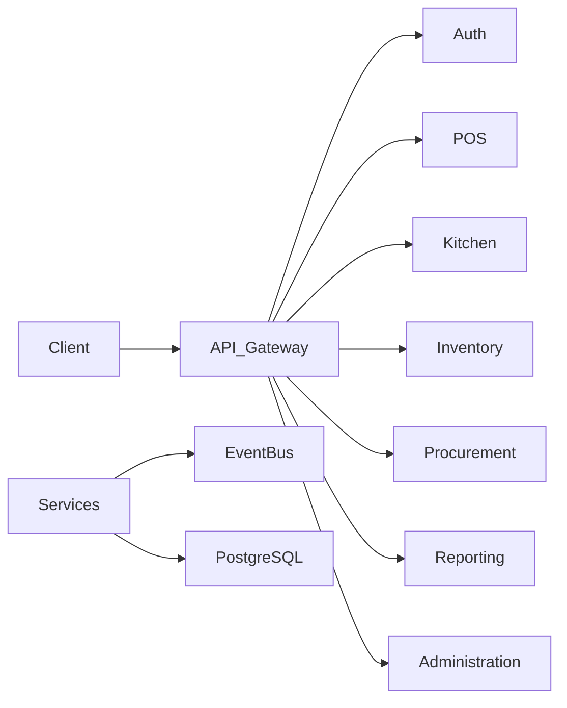

# 08_API_Specifications_01_OpenAPI_Overview.md

# Restaurant POS Enterprise Product Bible
## OpenAPI / Swagger Overview

**Module ID:** API-001

---

# 1. Purpose

This document defines the API standards, conventions and architectural principles used by every REST service in the Restaurant POS platform.

---

# 2. API Architecture



---

# 3. Standards

- RESTful APIs
- JSON payloads
- UTF-8 encoding
- HTTPS only
- JWT authentication
- OpenAPI 3.1
- ISO-8601 timestamps
- UUID identifiers

---

# 4. URL Convention

```
/api/v1/{module}/{resource}
```

Examples

```
GET /api/v1/orders
POST /api/v1/orders
GET /api/v1/orders/{id}
PATCH /api/v1/orders/{id}
DELETE /api/v1/orders/{id}
```

---

# 5. Authentication

```http
Authorization: Bearer <JWT>
X-Correlation-Id: uuid
X-Branch-Id: uuid
```

---

# 6. Standard Response

```json
{
  "success": true,
  "message": "Request completed",
  "data": {},
  "meta": {
    "requestId": "uuid",
    "timestamp": "2026-06-26T10:00:00Z"
  }
}
```

---

# 7. Standard Error

```json
{
  "success": false,
  "error": {
    "code": "ORDER_NOT_FOUND",
    "message": "Order not found"
  }
}
```

HTTP Status:
- 200 OK
- 201 Created
- 204 No Content
- 400 Bad Request
- 401 Unauthorized
- 403 Forbidden
- 404 Not Found
- 409 Conflict
- 422 Validation Error
- 429 Rate Limited
- 500 Internal Error

---

# 8. Pagination

```
GET /orders?page=1&pageSize=20
```

Response metadata:

```json
{
  "page":1,
  "pageSize":20,
  "totalRecords":542,
  "totalPages":28
}
```

---

# 9. Filtering & Sorting

Examples

```
GET /orders?status=PAID
GET /orders?branchId=...
GET /orders?sort=-createdAt
```

---

# 10. Idempotency

Required for:
- Payments
- Refunds
- Purchase Posting

Header

```
Idempotency-Key: uuid
```

---

# 11. Rate Limiting

Default:
- 100 requests/min/user
- 1000 requests/min/service

Headers:
- X-RateLimit-Limit
- X-RateLimit-Remaining
- Retry-After

---

# 12. Webhooks

Events:
- payment.completed
- order.closed
- inventory.low_stock
- purchase.received
- refund.completed

Retry:
- Exponential backoff
- Dead-letter queue after max retries

---

# 13. API Groups

1. Authentication
2. Users
3. POS
4. Tables
5. Kitchen
6. Payments
7. Inventory
8. Procurement
9. Reports
10. Administration
11. Notifications

---

# 14. Security

- JWT
- RBAC
- Input validation
- Output encoding
- TLS 1.3
- Secret rotation
- Correlation IDs
- Audit logging

---

# 15. OpenAPI Skeleton

```yaml
openapi: 3.1.0
info:
  title: Restaurant POS API
  version: 1.0.0
servers:
  - url: https://api.company.com/api/v1
paths: {}
components:
  securitySchemes:
    bearerAuth:
      type: http
      scheme: bearer
```

---

# 16. Roadmap

Subsequent API documents:

- 08_API_Specifications_02_Authentication_API.md
- 08_API_Specifications_03_POS_API.md
- 08_API_Specifications_04_Kitchen_API.md
- 08_API_Specifications_05_Inventory_API.md
- 08_API_Specifications_06_Procurement_API.md
- 08_API_Specifications_07_Reporting_API.md
- 08_API_Specifications_08_Admin_API.md

Target: 100+ fully documented endpoints with OpenAPI request/response schemas.
