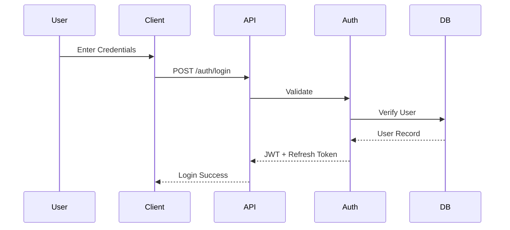

# 08_API_Specifications_02_Authentication_API.md

# Restaurant POS Enterprise Product Bible
## Authentication & Authorization API

**Module ID:** API-AUTH-002

---

# 1. Purpose

Defines all authentication, authorization, session, user profile and security-related REST APIs.

---

# 2. Authentication Flow



---

# 3. Endpoints

## POST /api/v1/auth/login

Purpose
Authenticate user.

Request

```json
{
  "username":"cashier01",
  "password":"********",
  "branchId":"uuid"
}
```

Success Response

```json
{
  "success":true,
  "data":{
    "accessToken":"jwt",
    "refreshToken":"jwt",
    "expiresIn":3600,
    "role":"Cashier"
  }
}
```

Errors
- INVALID_CREDENTIALS
- USER_LOCKED
- BRANCH_DISABLED

---

## POST /api/v1/auth/logout

Invalidates current session.

Returns:
204 No Content

---

## POST /api/v1/auth/refresh

Request

```json
{
  "refreshToken":"..."
}
```

Returns new JWT.

---

## POST /api/v1/auth/forgot-password

Input

```json
{
  "email":"user@example.com"
}
```

---

## POST /api/v1/auth/reset-password

Input

```json
{
  "token":"...",
  "password":"StrongPassword@123"
}
```

Validation
- Token valid
- Not expired
- Password policy met

---

## POST /api/v1/auth/change-password

Requires authenticated user.

Rules
- Current password required.
- Password history checked.
- Password complexity enforced.

---

## GET /api/v1/auth/profile

Returns
- User
- Role
- Branch
- Permissions

---

## GET /api/v1/auth/sessions

Lists active sessions.

---

## DELETE /api/v1/auth/sessions/{id}

Terminates selected session.

---

## POST /api/v1/auth/device/register

Registers trusted device.

---

# 4. Security Rules

- JWT expiry: 60 minutes
- Refresh Token expiry: 30 days
- Account lock after configurable failures
- Password history: last 5
- Session timeout configurable
- Trusted devices optional

---

# 5. Error Catalog

| Code | Description |
|------|-------------|
| INVALID_CREDENTIALS | Wrong username/password |
| ACCOUNT_LOCKED | Too many failures |
| TOKEN_EXPIRED | JWT expired |
| TOKEN_INVALID | Invalid token |
| PASSWORD_WEAK | Complexity failed |
| PASSWORD_REUSED | History violation |
| SESSION_EXPIRED | Idle timeout |

---

# 6. Business Rules

1. Only active users may login.
2. Branch assignment mandatory.
3. Refresh token rotation enabled.
4. Logout revokes refresh token.
5. Password reset invalidates all sessions.
6. Device registration audited.

---

# 7. QA Scenarios

- Successful login
- Invalid credentials
- Locked account
- Refresh token rotation
- Password reset
- Concurrent sessions
- Logout
- Device registration

---

# 8. Next

08_API_Specifications_03_POS_API.md
