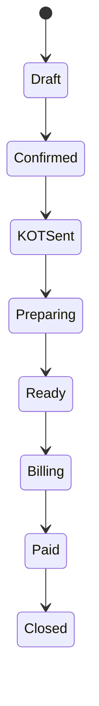
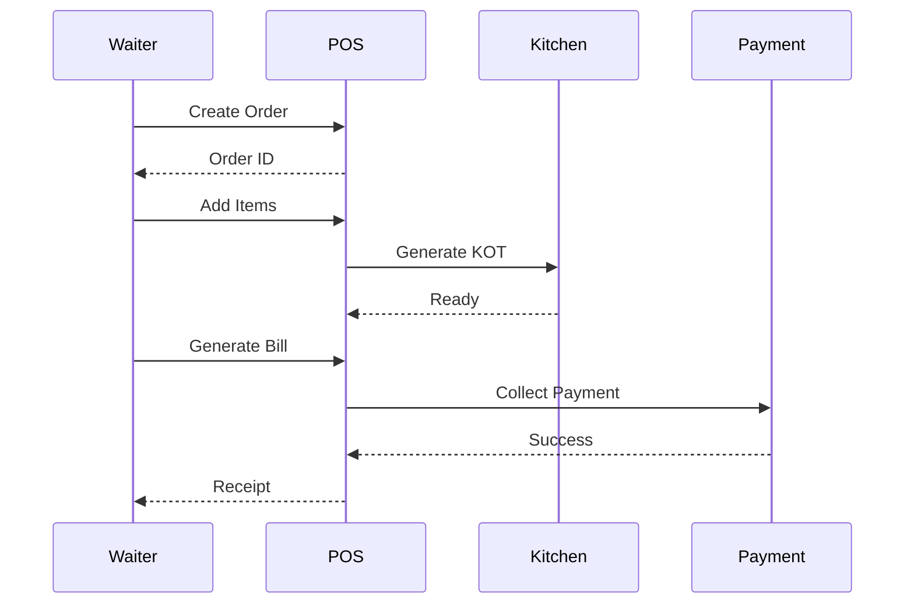

# 08_API_Specifications_03_POS_API.md

# Restaurant POS Enterprise Product Bible
## POS API Specification

**Module ID:** API-POS-003

---

# Purpose

Defines REST APIs for the core POS transaction engine including menu, tables, orders, KOT, billing, discounts and receipts.

---

# API Domains

1. Menu
2. Tables
3. Orders
4. Order Items
5. Modifiers
6. Discounts
7. Taxes
8. KOT
9. Billing
10. Receipts

---

# Order Lifecycle



---

# Sequence



---

# Menu APIs

## GET /api/v1/menu
Returns active menu.

Filters
- categoryId
- search
- branchId

## GET /api/v1/menu/{id}

## GET /api/v1/menu/categories

---

# Table APIs

GET /api/v1/tables

POST /api/v1/tables/{id}/open

POST /api/v1/tables/transfer

POST /api/v1/tables/merge

POST /api/v1/tables/split

---

# Order APIs

POST /api/v1/orders

Request

```json
{
  "tableId":"uuid",
  "orderType":"DINE_IN"
}
```

GET /api/v1/orders/{id}

PATCH /api/v1/orders/{id}

DELETE /api/v1/orders/{id}

---

# Order Item APIs

POST /api/v1/orders/{id}/items

PATCH /api/v1/orders/{id}/items/{itemId}

DELETE /api/v1/orders/{id}/items/{itemId}

---

# Modifier APIs

GET /api/v1/modifiers/{groupId}

POST /api/v1/orders/{id}/modifiers

---

# Discount APIs

POST /api/v1/orders/{id}/discount

POST /api/v1/orders/{id}/discount/approve

Rules
- Manager approval above threshold.

---

# Tax APIs

GET /api/v1/taxes

GET /api/v1/orders/{id}/tax-summary

---

# KOT APIs

POST /api/v1/kot

GET /api/v1/kot/{id}

POST /api/v1/kot/{id}/cancel

Rules
- Incremental KOT only contains unsent items.

---

# Billing APIs

POST /api/v1/orders/{id}/bill

POST /api/v1/orders/{id}/hold

POST /api/v1/orders/{id}/recall

POST /api/v1/orders/{id}/close

---

# Receipt APIs

GET /api/v1/receipts/{id}

POST /api/v1/receipts/{id}/reprint

---

# Standard Error Codes

- ORDER_NOT_FOUND
- TABLE_OCCUPIED
- ITEM_INACTIVE
- KOT_ALREADY_SENT
- PAYMENT_PENDING
- INVALID_DISCOUNT
- RECEIPT_NOT_AVAILABLE

---

# Idempotent APIs

- POST /payments
- POST /kot
- POST /orders/{id}/close

Header:
Idempotency-Key: uuid

---

# Business Rules

1. One active order per table.
2. Paid orders immutable.
3. KOT immutable after generation.
4. Bill generated once.
5. Receipt linked to payment.
6. Duplicate requests ignored using idempotency key.

---

# QA Focus

- Concurrent edits
- Duplicate KOT
- Table transfer
- Merge conflict
- Hold/Recall
- Discount approval
- Receipt reprint

---

# Next

08_API_Specifications_04_Kitchen_API.md
