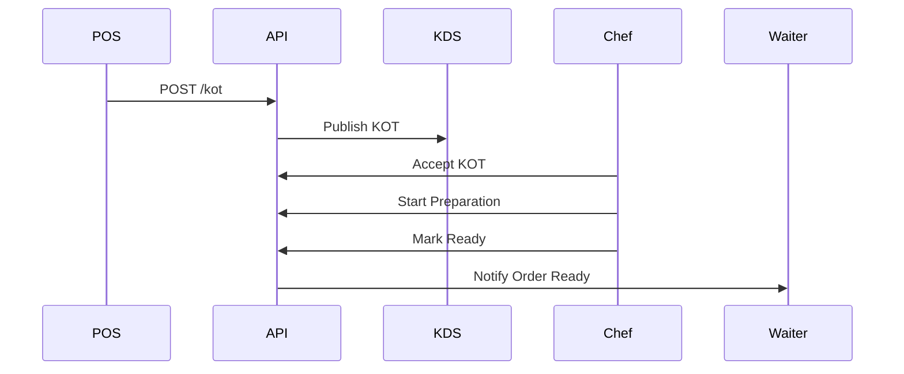
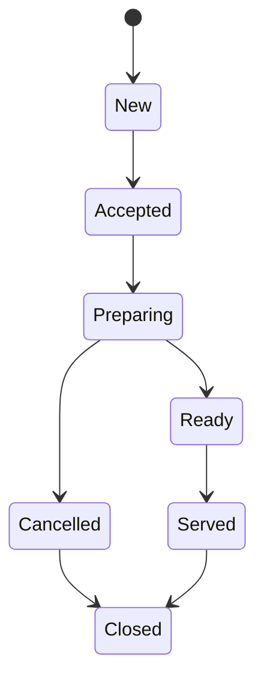

# 08_API_Specifications_04_Kitchen_API.md

# Restaurant POS Enterprise Product Bible
## Kitchen Display System (KDS) API Specification

**Module ID:** API-KDS-004

---

# 1. Purpose

Defines REST APIs and event contracts for Kitchen Display System (KDS), Kitchen Order Tickets (KOT), station routing, preparation lifecycle, SLA tracking, and waiter notifications.

---

# 2. Kitchen Flow



---

# 3. Kitchen State Machine



---

# 4. API Groups

- Kitchen Queue
- Kitchen Stations
- KOT
- Preparation
- SLA
- Notifications

---

# 5. Queue APIs

## GET /api/v1/kitchen/queue

Returns active kitchen queue.

Filters:
- stationId
- status
- priority

---

## GET /api/v1/kitchen/orders/{id}

Returns complete kitchen order details.

---

# 6. Station APIs

GET /api/v1/kitchen/stations

GET /api/v1/kitchen/stations/{id}

PATCH /api/v1/kitchen/stations/{id}/status

Status:
- Active
- Busy
- Offline
- Maintenance

---

# 7. KOT APIs

POST /api/v1/kot

Request

```json
{
  "orderId":"uuid"
}
```

GET /api/v1/kot/{id}

POST /api/v1/kot/{id}/cancel

Business Rules
- Incremental KOT generation.
- Immutable after publish.

---

# 8. Preparation APIs

POST /api/v1/kitchen/orders/{id}/accept

POST /api/v1/kitchen/orders/{id}/start

POST /api/v1/kitchen/orders/{id}/ready

POST /api/v1/kitchen/orders/{id}/served

---

# 9. SLA APIs

GET /api/v1/kitchen/sla

GET /api/v1/kitchen/performance

KPIs
- Avg Preparation Time
- Delayed Orders
- Ready Queue
- Station Utilization

---

# 10. Notification APIs

POST /api/v1/kitchen/notify-ready

POST /api/v1/kitchen/escalate-delay

---

# 11. WebSocket Events

- kot.created
- kot.accepted
- preparation.started
- preparation.ready
- order.served
- station.offline

---

# 12. Error Codes

- KOT_NOT_FOUND
- KOT_ALREADY_ACCEPTED
- INVALID_STATE
- STATION_OFFLINE
- ORDER_ALREADY_READY
- SLA_EXCEEDED

---

# 13. Business Rules

1. Only assigned station may accept KOT.
2. Ready requires Preparing state.
3. Cancel after Preparing requires approval.
4. Duplicate Ready ignored.
5. Waiter notified immediately after Ready.
6. SLA breach raises event.

---

# 14. Idempotent Operations

- Accept KOT
- Ready
- Served

Header:
Idempotency-Key: uuid

---

# 15. QA Focus

- Concurrent acceptance
- Station routing
- SLA timers
- Duplicate ready
- Notification delivery
- Offline station recovery

---

# 16. Next

08_API_Specifications_05_Inventory_API.md
