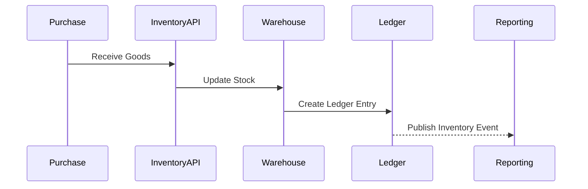

# 08_API_Specifications_05_Inventory_API.md

# Restaurant POS Enterprise Product Bible
## Inventory & Warehouse API Specification

**Module ID:** API-INV-005

---

# 1. Purpose

Defines REST APIs for inventory operations including stock receipts, warehouse transfers, adjustments, stock counts, valuation, batch management, reorder processing, and inventory reporting.

---

# 2. Inventory Service Flow

---

# 3. API Domains

1. Inventory Items
2. Warehouses
3. Stock Ledger
4. Goods Receipt
5. Transfers
6. Stock Adjustment
7. Physical Count
8. Batch Management
9. Valuation
10. Reorder

---

# 4. Inventory Item APIs

GET /api/v1/inventory/items

GET /api/v1/inventory/items/{id}

POST /api/v1/inventory/items

PATCH /api/v1/inventory/items/{id}

DELETE /api/v1/inventory/items/{id}

Validation
- SKU unique
- Barcode unique (optional)
- UOM mandatory

---

# 5. Warehouse APIs

GET /api/v1/warehouses

POST /api/v1/warehouses

PATCH /api/v1/warehouses/{id}

GET /api/v1/warehouses/{id}/stock

---

# 6. Goods Receipt APIs

POST /api/v1/inventory/receipts

GET /api/v1/inventory/receipts/{id}

Business Rules
- Linked to approved purchase.
- Creates immutable ledger entries.

---

# 7. Stock Ledger APIs

GET /api/v1/inventory/ledger

GET /api/v1/inventory/ledger/{itemId}

Filters
- warehouseId
- itemId
- dateRange
- transactionType

---

# 8. Transfer APIs

POST /api/v1/inventory/transfers

PATCH /api/v1/inventory/transfers/{id}/approve

PATCH /api/v1/inventory/transfers/{id}/ship

PATCH /api/v1/inventory/transfers/{id}/receive

States
Draft → Approved → Shipped → Received → Closed

---

# 9. Adjustment APIs

POST /api/v1/inventory/adjustments

Reasons
- Damage
- Theft
- Expiry
- Wastage
- Correction

Approval required above threshold.

---

# 10. Stock Count APIs

POST /api/v1/inventory/counts

PATCH /api/v1/inventory/counts/{id}/submit

PATCH /api/v1/inventory/counts/{id}/approve

Rules
- Freeze inventory during count.
- Variance calculated automatically.

---

# 11. Batch APIs

GET /api/v1/inventory/batches

POST /api/v1/inventory/batches

PATCH /api/v1/inventory/batches/{id}

Supports
- Batch
- Lot
- Expiry
- FEFO allocation

---

# 12. Valuation APIs

GET /api/v1/inventory/valuation

GET /api/v1/inventory/value-history

Methods
- Weighted Average
- FIFO (future)
- FEFO-ready

---

# 13. Reorder APIs

GET /api/v1/inventory/reorder

POST /api/v1/inventory/reorder/generate-po

Triggers
- Min stock reached
- Safety stock breach

---

# 14. WebSocket Events

- inventory.received
- inventory.transferred
- inventory.adjusted
- inventory.count.completed
- inventory.low_stock
- inventory.expiry_alert

---

# 15. Error Codes

- ITEM_NOT_FOUND
- NEGATIVE_STOCK
- BATCH_EXPIRED
- WAREHOUSE_NOT_FOUND
- TRANSFER_CONFLICT
- COUNT_ALREADY_OPEN

---

# 16. Business Rules

1. Ledger is append-only.
2. Negative stock blocked unless configured.
3. Batch depletion follows FEFO when enabled.
4. Stock count locks affected inventory.
5. Every movement creates an audit event.
6. Reorder generation is idempotent.

---

# 17. QA Focus

- Concurrent transfers
- Stock count approval
- Duplicate receipts
- Ledger integrity
- Batch expiry
- Reorder generation
- Offline synchronization

---

# 18. Next

08_API_Specifications_06_Procurement_API.md
