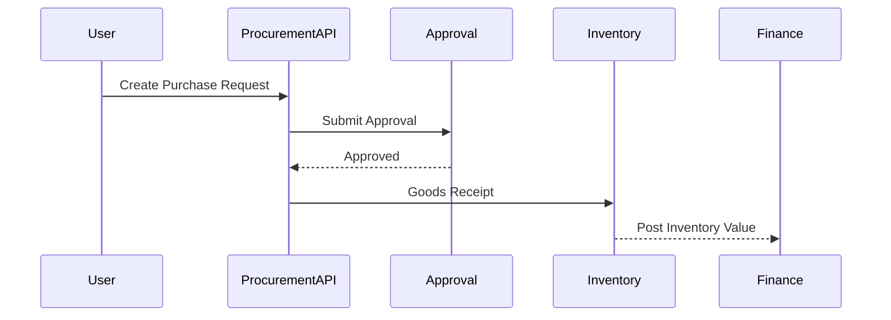

# 08_API_Specifications_06_Procurement_API.md

# Restaurant POS Enterprise Product Bible
## Procurement API Specification

**Module ID:** API-PROC-006

---

# 1. Purpose

Defines REST APIs for procurement covering supplier management, purchase requests, purchase orders, goods receipts, purchase invoices, landed costs, supplier payments, returns, and approval workflows.

---

# 2. Procurement Flow

---

# 3. API Domains

1. Suppliers
2. Purchase Requests
3. Purchase Orders
4. Goods Receipts (GRN)
5. Purchase Invoices
6. Landed Costs
7. Supplier Payments
8. Purchase Returns
9. Approvals

---

# 4. Supplier APIs

GET /api/v1/suppliers

GET /api/v1/suppliers/{id}

POST /api/v1/suppliers

PATCH /api/v1/suppliers/{id}

DELETE /api/v1/suppliers/{id}

Validation
- Supplier code unique
- GST validation
- Credit limit >= 0

---

# 5. Purchase Request APIs

POST /api/v1/purchase-requests

GET /api/v1/purchase-requests

PATCH /api/v1/purchase-requests/{id}

POST /api/v1/purchase-requests/{id}/submit

States:
Draft → Submitted → Approved → Converted

---

# 6. Purchase Order APIs

POST /api/v1/purchase-orders

GET /api/v1/purchase-orders

GET /api/v1/purchase-orders/{id}

PATCH /api/v1/purchase-orders/{id}

POST /api/v1/purchase-orders/{id}/approve

POST /api/v1/purchase-orders/{id}/cancel

Business Rules
- Supplier mandatory
- At least one line item
- Approval threshold configurable

---

# 7. Goods Receipt APIs

POST /api/v1/goods-receipts

GET /api/v1/goods-receipts/{id}

PATCH /api/v1/goods-receipts/{id}/complete

Rules
- Linked to approved PO
- Creates inventory ledger entries
- Partial receipt supported

---

# 8. Purchase Invoice APIs

POST /api/v1/purchase-invoices

GET /api/v1/purchase-invoices

PATCH /api/v1/purchase-invoices/{id}

Validation
- Duplicate invoice blocked
- Invoice date required
- Supplier must match PO

---

# 9. Landed Cost APIs

POST /api/v1/landed-costs

GET /api/v1/landed-costs/{id}

Allocation Methods
- By Value
- By Quantity
- By Weight
- Equal

---

# 10. Supplier Payment APIs

POST /api/v1/supplier-payments

GET /api/v1/supplier-payments

Rules
- Approved invoice only
- Prevent duplicate settlement

---

# 11. Purchase Return APIs

POST /api/v1/purchase-returns

GET /api/v1/purchase-returns/{id}

PATCH /api/v1/purchase-returns/{id}/approve

States:
Draft → Approved → Returned → Closed

---

# 12. Approval APIs

POST /api/v1/approvals/{entity}/{id}

GET /api/v1/approvals/pending

---

# 13. WebSocket Events

- supplier.created
- purchase-request.approved
- purchase-order.approved
- goods-received
- purchase-invoice.posted
- supplier-payment.completed
- purchase-return.closed

---

# 14. Error Codes

- SUPPLIER_NOT_FOUND
- DUPLICATE_INVOICE
- PO_NOT_APPROVED
- GRN_ALREADY_POSTED
- INVALID_APPROVAL
- CREDIT_LIMIT_EXCEEDED

---

# 15. Business Rules

1. PO approval required before GRN.
2. GRN updates inventory.
3. Invoice references GRN/PO.
4. Supplier payments only for approved invoices.
5. Returns reverse inventory movements.
6. Approval actions are fully audited.

---

# 16. QA Focus

- Duplicate supplier
- Approval workflow
- Partial GRN
- Duplicate invoice
- Landed cost allocation
- Return processing
- Payment reconciliation

---

# 17. Next

08_API_Specifications_07_Reporting_API.md
