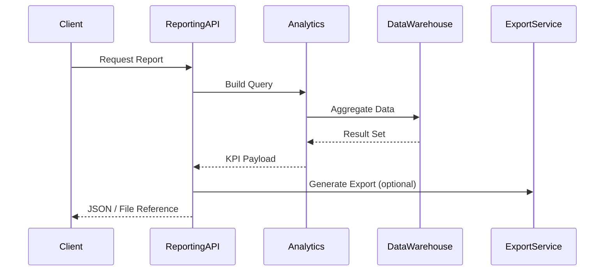

# 08_API_Specifications_07_Reporting_API.md

# Restaurant POS Enterprise Product Bible
## Reporting & Analytics API Specification

**Module ID:** API-RPT-007

---

# 1. Purpose

Defines REST APIs for dashboards, KPIs, operational reports, financial reports, inventory analytics, kitchen analytics, procurement analytics, scheduled reports, exports, and drill-down capabilities.

---

# 2. Reporting Flow

---

# 3. API Domains

1. Dashboards
2. KPIs
3. Sales Reports
4. Financial Reports
5. Inventory Reports
6. Kitchen Reports
7. Procurement Reports
8. Audit Reports
9. Scheduled Reports
10. Export Services

---

# 4. Dashboard APIs

GET /api/v1/reports/dashboard

GET /api/v1/reports/dashboard/widgets

GET /api/v1/reports/dashboard/summary

Filters
- branchId
- dateRange
- shiftId

---

# 5. KPI APIs

GET /api/v1/reports/kpi

KPIs
- Gross Sales
- Net Sales
- Average Bill
- Food Cost %
- Table Turnover
- Refund %
- Inventory Value

---

# 6. Sales Report APIs

GET /api/v1/reports/sales

GET /api/v1/reports/sales/hourly

GET /api/v1/reports/sales/items

GET /api/v1/reports/sales/categories

GET /api/v1/reports/sales/waiters

---

# 7. Financial Report APIs

GET /api/v1/reports/payments

GET /api/v1/reports/taxes

GET /api/v1/reports/discounts

GET /api/v1/reports/refunds

---

# 8. Inventory Report APIs

GET /api/v1/reports/inventory

GET /api/v1/reports/inventory/ledger

GET /api/v1/reports/inventory/valuation

GET /api/v1/reports/inventory/expiry

GET /api/v1/reports/inventory/variance

---

# 9. Kitchen Report APIs

GET /api/v1/reports/kitchen

GET /api/v1/reports/kitchen/sla

GET /api/v1/reports/kitchen/stations

Metrics
- Avg Prep Time
- SLA Breaches
- Ready Queue
- Station Utilization

---

# 10. Procurement Report APIs

GET /api/v1/reports/purchases

GET /api/v1/reports/suppliers

GET /api/v1/reports/price-variance

---

# 11. Audit Report APIs

GET /api/v1/reports/audit

GET /api/v1/reports/security

GET /api/v1/reports/activity

---

# 12. Scheduled Report APIs

POST /api/v1/reports/schedule

GET /api/v1/reports/schedule

DELETE /api/v1/reports/schedule/{id}

---

# 13. Export APIs

POST /api/v1/reports/export

Formats
- PDF
- Excel
- CSV

---

# 14. Drill-down APIs

GET /api/v1/reports/drilldown/orders

GET /api/v1/reports/drilldown/inventory

GET /api/v1/reports/drilldown/payments

---

# 15. Error Codes

- REPORT_NOT_FOUND
- INVALID_DATE_RANGE
- EXPORT_FAILED
- REPORT_TIMEOUT
- PERMISSION_DENIED
- SCHEDULE_NOT_FOUND

---

# 16. Business Rules

1. RBAC applied to every report.
2. Scheduled reports require valid recipients.
3. Export actions logged.
4. Long-running reports processed asynchronously.
5. Dashboard data cached.
6. Drill-down honors branch permissions.

---

# 17. QA Focus

- Dashboard refresh
- Export validation
- Schedule execution
- KPI accuracy
- Drill-down navigation
- RBAC enforcement

---

# 18. Next

08_API_Specifications_08_Admin_API.md
