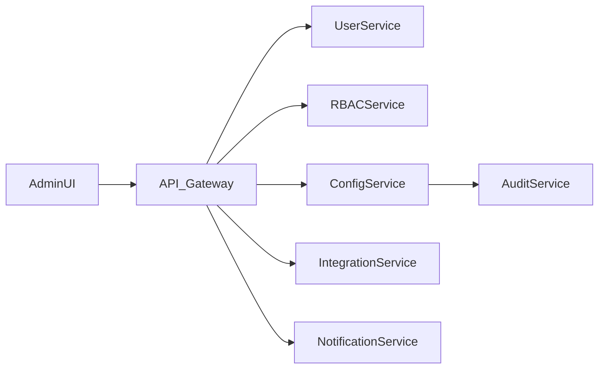

# 08_API_Specifications_08_Admin_API.md

# Restaurant POS Enterprise Product Bible
## Administration & Configuration API Specification

**Module ID:** API-ADM-008

---

# 1. Purpose

Defines REST APIs for administration, master data, configuration, RBAC, integrations, feature flags, notifications, printers, tax configuration, and system settings.

---

# 2. Administration Architecture

---

# 3. API Domains

1. Users
2. Roles
3. Permissions
4. Branches
5. System Settings
6. Taxes
7. Payment Modes
8. Printers
9. Kitchen Stations
10. Notification Templates
11. Feature Flags
12. Integrations
13. Configuration Versioning

---

# 4. User APIs

GET /api/v1/admin/users

GET /api/v1/admin/users/{id}

POST /api/v1/admin/users

PATCH /api/v1/admin/users/{id}

DELETE /api/v1/admin/users/{id}

Rules
- Username unique
- Branch assignment mandatory
- Soft delete only

---

# 5. Role & Permission APIs

GET /api/v1/admin/roles

POST /api/v1/admin/roles

PATCH /api/v1/admin/roles/{id}

GET /api/v1/admin/permissions

POST /api/v1/admin/roles/{id}/permissions

Business Rules
- System roles protected
- Permission changes audited

---

# 6. Branch APIs

GET /api/v1/admin/branches

POST /api/v1/admin/branches

PATCH /api/v1/admin/branches/{id}

Rules
- Branch code unique
- Cannot disable branch with open shift

---

# 7. System Settings APIs

GET /api/v1/admin/settings

POST /api/v1/admin/settings

PATCH /api/v1/admin/settings/{key}

Supports:
- POS settings
- Inventory settings
- Kitchen settings
- Payment settings

---

# 8. Tax APIs

GET /api/v1/admin/taxes

POST /api/v1/admin/taxes

PATCH /api/v1/admin/taxes/{id}

DELETE /api/v1/admin/taxes/{id}

Validation
- Effective dates cannot overlap
- Versioned updates

---

# 9. Payment Mode APIs

GET /api/v1/admin/payment-modes

POST /api/v1/admin/payment-modes

PATCH /api/v1/admin/payment-modes/{id}

---

# 10. Printer & Kitchen APIs

GET /api/v1/admin/printers
POST /api/v1/admin/printers

GET /api/v1/admin/kitchen-stations
POST /api/v1/admin/kitchen-stations

Rules
- One printer may serve multiple stations
- Station SLA configurable

---

# 11. Notification APIs

GET /api/v1/admin/notification-templates

POST /api/v1/admin/notification-templates

POST /api/v1/admin/notifications/test

Channels
- Email
- SMS
- WhatsApp
- Push
- Webhook

---

# 12. Feature Flag APIs

GET /api/v1/admin/feature-flags

POST /api/v1/admin/feature-flags

PATCH /api/v1/admin/feature-flags/{id}

Supports
- Gradual rollout
- Branch rollout
- Environment rollout

---

# 13. Integration APIs

GET /api/v1/admin/integrations

POST /api/v1/admin/integrations

PATCH /api/v1/admin/integrations/{id}

POST /api/v1/admin/integrations/{id}/test

Examples
- Payment Gateway
- ERP
- SMS
- WhatsApp
- Accounting

---

# 14. Configuration Version APIs

GET /api/v1/admin/configuration/versions

POST /api/v1/admin/configuration/publish

POST /api/v1/admin/configuration/rollback

---

# 15. Error Codes

- USER_ALREADY_EXISTS
- ROLE_NOT_FOUND
- BRANCH_LOCKED
- INVALID_TAX_PROFILE
- FEATURE_FLAG_CONFLICT
- INTEGRATION_TEST_FAILED
- CONFIGURATION_ROLLBACK_FAILED

---

# 16. Business Rules

1. All admin APIs require elevated RBAC.
2. Every configuration change creates an audit record.
3. Secrets are never returned in API responses.
4. Feature flags are version-controlled.
5. Rollback restores previous published configuration.
6. Integration tests never expose credentials.

---

# 17. QA Focus

- RBAC enforcement
- Configuration versioning
- Tax validation
- Feature rollout
- Integration testing
- Printer mapping
- Audit verification

---

# 18. Completion of API Section

This document completes the API Specifications section.

## Next Major Section

# 09_Business_Rules_01_Core_Business_Rules.md

The Business Rules repository will define:
- 200–300 implementation rules
- Validation rules
- Decision tables
- Approval matrices
- Calculation logic
- Exception handling
- Cross-module dependencies
