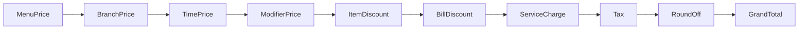

# 09_Business_Rules_02_Order_Pricing_Rules.md

# Restaurant POS Enterprise Product Bible
## Order & Pricing Business Rules

**Module ID:** BR-002

---

# 1. Purpose

Defines the pricing engine, taxation logic, discount hierarchy, service charges, rounding, combo pricing, modifier pricing, coupons, and bill allocation rules.

---

# 2. Pricing Calculation Pipeline

---

# 3. Price Resolution Hierarchy

| Priority | Rule |
|---:|---|
|1|Manual manager override (if permitted)|
|2|Promotional/Happy Hour price|
|3|Branch-specific price|
|4|Default menu price|

---

# 4. Pricing Rules

### PRI-001
Every menu item must have an active base price.

### PRI-002
Branch-specific price overrides the default price.

### PRI-003
Only one promotional price may be active for an item at a given time.

### PRI-004
Expired promotional prices are ignored.

### PRI-005
Future prices become effective only on their effective date.

---

# 5. Modifier Rules

MOD-001 Modifier groups determine valid modifier choices.

MOD-002 Required modifier groups must be completed before adding an item.

MOD-003 Modifier price delta is added before discounts.

MOD-004 Duplicate modifiers are prevented unless explicitly allowed.

MOD-005 Modifier removal recalculates totals immediately.

---

# 6. Combo Rules

COM-001 Combo price overrides individual item prices.

COM-002 Optional upgrades apply only to configured items.

COM-003 Removed combo items do not create negative pricing.

COM-004 Combo substitutions require configuration.

---

# 7. Discount Rules

DISC-001 Item discounts apply before bill discounts.

DISC-002 Highest-priority eligible discount wins unless stacking is enabled.

DISC-003 Manager approval required above configured threshold.

DISC-004 Discount reason mandatory when configured.

DISC-005 Paid bills cannot receive new discounts.

---

# 8. Coupon Rules

COUP-001 Coupon validity dates enforced.

COUP-002 Minimum bill value validated.

COUP-003 Customer eligibility validated.

COUP-004 One-time coupons cannot be reused.

COUP-005 Invalid coupons return explicit error.

---

# 9. Tax Rules

TAX-001 Taxes calculated after item discounts.

TAX-002 Inclusive and exclusive tax profiles supported.

TAX-003 Tax profile resolved from menu item.

TAX-004 Historical transactions retain original tax version.

---

# 10. Service Charge Rules

SC-001 Configurable by branch.

SC-002 May be percentage or fixed amount.

SC-003 Exempt customers supported via policy.

---

# 11. Rounding Rules

ROUND-001 Applied only after all calculations.

ROUND-002 Rounding precision configurable.

ROUND-003 Round adjustment displayed separately.

---

# 12. Split Bill Rules

SPLIT-001 Split by seat.

SPLIT-002 Split by item.

SPLIT-003 Equal split supported.

SPLIT-004 Sum of split bills must equal original bill.

---

# 13. Formula Library

Item Total =
(Base Price + Modifier Total) × Qty

Bill Subtotal =
Σ Item Totals

Grand Total =
Subtotal
− Discounts
+ Service Charge
+ Taxes
± Round Off

---

# 14. Decision Table

| Condition | Result |
|---|---|
|Happy Hour Active|Use Promotional Price|
|Branch Price Exists|Override Default|
|Discount > Limit|Manager Approval|
|Coupon Invalid|Reject Coupon|
|Tax Inclusive|Extract Tax|

---

# 15. Edge Cases

1. Promotion overlaps.
2. Branch price missing.
3. Modifier deleted after ordering.
4. Coupon expires during checkout.
5. Tax profile changed mid-order.
6. Negative grand total attempt.
7. Multiple round-off policies.
8. Combo item unavailable.
9. Discount on complimentary bill.
10. Split bill after partial payment.

---

# 16. QA Traceability

- Branch pricing
- Happy hour pricing
- Modifier pricing
- Combo calculations
- Discount approval
- Tax validation
- Split billing
- Coupon validation

---

# Next

09_Business_Rules_03_Inventory_Procurement_Rules.md
