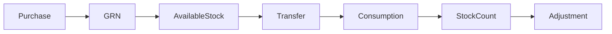

# 09_Business_Rules_03_Inventory_Procurement_Rules.md

# Restaurant POS Enterprise Product Bible
## Inventory & Procurement Business Rules

**Module ID:** BR-003

## Purpose
Implementation rules governing inventory movement, procurement, valuation, warehouse operations and purchasing.

### Inventory Lifecycle

## Stock Rules
- INV-001 Every inventory movement creates an immutable ledger entry.
- INV-002 Inventory balance is ledger-derived.
- INV-003 Negative stock blocked unless configured.
- INV-004 Reference document mandatory.
- INV-005 All inventory changes audited.

## Batch Rules
- BAT-001 Batch required for tracked items.
- BAT-002 Expiry required where enabled.
- BAT-003 FEFO allocation supported.
- BAT-004 Expired stock blocked by policy.
- BAT-005 Empty batches retained.

## Warehouse Rules
- WH-001 Source warehouse must have stock.
- WH-002 Destination warehouse must be active.
- WH-003 Transfer creates inbound/outbound ledger.
- WH-004 Receipt confirms ownership.
- WH-005 One default warehouse per branch.

## Stock Count Rules
- CNT-001 One active count per zone.
- CNT-002 Count freezes stock.
- CNT-003 Variance auto-calculated.
- CNT-004 Large variance needs approval.
- CNT-005 Approved count updates inventory.

Formula:
Variance = Physical Qty - System Qty

## Valuation Rules
- VAL-001 Weighted Average default.
- VAL-002 FIFO future-ready.
- VAL-003 Historical valuation immutable.
- VAL-004 Landed cost updates average cost.

## Reorder Rules
- REO-001 Trigger when available <= minimum.
- REO-002 Preferred supplier selected.
- REO-003 Duplicate auto PO prevented.
- REO-004 Safety stock configurable.

## Procurement Rules
- PUR-001 Supplier active.
- PUR-002 PR requires line items.
- PUR-003 Approved PR -> PO.
- PUR-004 PO approval before GRN.
- PUR-005 Partial receipt supported.
- PUR-006 Duplicate invoice blocked.
- PUR-007 Closed PO immutable.

## Landed Cost Rules
- Allocate by value, quantity, weight or equal.
- Recalculate inventory valuation.
- Preserve allocation history.

## Purchase Return Rules
- Return <= received quantity.
- Approved return reverses inventory.
- Credit note reference configurable.

## Decision Table

|Condition|Action|
|---|---|
|Low Stock|Generate PO|
|Expired Batch|Block Issue|
|Variance High|Manager Approval|
|Duplicate Invoice|Reject|
|PO Pending|Reject GRN|

## Edge Cases
1. Duplicate GRN
2. Over receipt
3. Under receipt
4. Partial delivery
5. Warehouse disabled
6. Transfer during count
7. Batch conflict
8. Expired receipt
9. Offline sync
10. Currency mismatch

## QA
- Stock receipt
- Transfer
- Count
- FEFO
- Valuation
- Invoice validation

Next: 09_Business_Rules_04_Payment_Security_Admin_Rules.md
