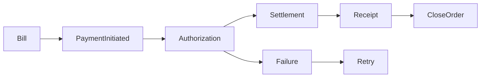

# 09_Business_Rules_04_Payment_Security_Admin_Rules.md

# Restaurant POS Enterprise Product Bible
## Payment, Security & Administration Business Rules

**Module ID:** BR-004

---

# 1. Purpose

Defines implementation rules for payments, refunds, cashier operations, security, RBAC, administration, configuration governance, and compliance.

---

# 2. Payment Lifecycle

# 3. Payment Rules

PAY-101 Cash received must be greater than or equal to payable amount.

PAY-102 Sum of split tenders must equal the bill total.

PAY-103 Duplicate payment requests are prevented using idempotency keys.

PAY-104 Gateway success is confirmed only after callback validation.

PAY-105 Receipt is generated only after successful settlement.

PAY-106 Complimentary bills require manager approval.

PAY-107 Refund amount cannot exceed original settled amount.

PAY-108 Void operations require approval and audit logging.

---

# 4. Refund Rules

REF-001 Refund reason mandatory.

REF-002 Partial refunds supported.

REF-003 Original payment reference required.

REF-004 Refund creates immutable audit record.

---

# 5. Cash Drawer Rules

CD-001 Drawer opens only after authorized cash transaction.

CD-002 Every open event is logged.

CD-003 Shift cannot close with unresolved variance.

CD-004 Cash count variance above tolerance requires approval.

---

# 6. Shift Rules

SHIFT-001 Only one active cashier shift per terminal.

SHIFT-002 Shift opening balance mandatory.

SHIFT-003 Shift close requires reconciliation.

SHIFT-004 Pending orders block shift closure unless overridden.

---

# 7. Security Rules

SEC-101 JWT mandatory for protected APIs.

SEC-102 RBAC evaluated on every request.

SEC-103 Password complexity enforced.

SEC-104 Password reuse prevented.

SEC-105 Session timeout configurable.

SEC-106 Failed login threshold locks account.

SEC-107 Secrets encrypted at rest.

SEC-108 Sensitive operations require audit entries.

---

# 8. Administration Rules

ADM-101 Configuration changes are versioned.

ADM-102 Feature flags require publish workflow.

ADM-103 System roles cannot be deleted.

ADM-104 Branch deletion prohibited when transactions exist.

ADM-105 Tax profile changes never affect historical transactions.

ADM-106 Configuration rollback restores last published version.

---

# 9. Decision Table

| Condition | Action |
|---|---|
|Refund > Approval Limit|Manager Approval|
|Cash Variance > Tolerance|Escalate|
|Invalid JWT|Reject Request|
|Role Missing Permission|403 Forbidden|
|Config Publish Failed|Rollback|

---

# 10. Exception Handling

- Gateway timeout → retry safely.
- Duplicate callback → ignore.
- Session expired → force re-authentication.
- Rollback failed → raise critical alert.
- Audit service unavailable → queue event.

---

# 11. QA Traceability

- Split payment
- Refund workflow
- Shift reconciliation
- RBAC validation
- Password policy
- Feature flag rollout
- Configuration rollback

---

# Next

09_Business_Rules_05_Reporting_Audit_Rules.md
