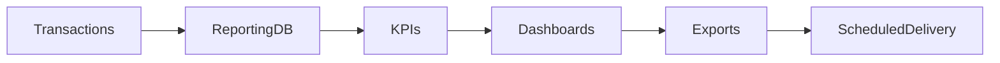

# 09_Business_Rules_05_Reporting_Audit_Rules.md

# Restaurant POS Enterprise Product Bible
## Reporting, Audit & Compliance Business Rules

**Module ID:** BR-005

---

# 1. Purpose

Defines implementation rules governing reporting, analytics, dashboards, audit logging, compliance, retention, event publishing and observability.

---

# 2. Reporting Pipeline

# 3. Reporting Rules

RPT-101 Reports respect RBAC and branch access.

RPT-102 KPI calculations use only posted transactions.

RPT-103 Cancelled orders excluded unless explicitly requested.

RPT-104 Dashboard widgets use cache when valid.

RPT-105 Long-running reports execute asynchronously.

RPT-106 Drill-down data must reconcile with summary totals.

---

# 4. KPI Rules

- Gross Sales = Sum of posted sales.
- Net Sales = Gross - Discounts.
- Food Cost % = Consumption / Net Sales.
- Average Bill = Net Sales / Paid Bills.
- Refund % = Refund Amount / Net Sales.

---

# 5. Export Rules

EXP-001 Supported formats: PDF, Excel, CSV.

EXP-002 Export actions are audited.

EXP-003 Sensitive reports may be watermarked.

EXP-004 Export size limits are configurable.

---

# 6. Scheduled Report Rules

SCH-001 Valid recipients required.

SCH-002 Failed delivery retried with exponential backoff.

SCH-003 Duplicate schedules prevented.

SCH-004 Expired schedules disabled automatically.

---

# 7. Audit Rules

AUD-101 Every financial mutation generates an immutable audit record.

AUD-102 Before/after values captured for configuration changes.

AUD-103 Correlation ID stored for every API request.

AUD-104 Audit records are append-only.

AUD-105 Audit timestamps use UTC.

---

# 8. Event Rules

EVT-001 Every state transition publishes a domain event.

EVT-002 Failed event delivery retries automatically.

EVT-003 Duplicate events ignored using event IDs.

EVT-004 Event ordering preserved within aggregate.

---

# 9. Retention Rules

| Artifact | Online | Archive |
|---|---:|---:|
|Audit Logs|5 Years|7 Years|
|API Logs|90 Days|1 Year|
|Reports|1 Year|5 Years|
|Events|1 Year|5 Years|

---

# 10. Compliance Rules

- Historical financial records are immutable.
- Personally identifiable information follows retention policy.
- Deleted users remain referenced in audit history.
- Configuration changes never rewrite historical transactions.

---

# 11. Decision Table

| Condition | Action |
|---|---|
|Large Report|Async Processing|
|Unauthorized Report|403|
|Export Failure|Retry|
|Audit Store Down|Queue Audit Event|
|Cache Expired|Rebuild Dataset|

---

# 12. Exception Handling

- Cache miss → rebuild.
- Export timeout → async retry.
- Audit outage → durable queue.
- Event bus unavailable → retry with backoff.
- Partial aggregation → mark report incomplete.

---

# 13. QA Traceability

- KPI accuracy
- Dashboard cache
- Export validation
- Scheduled reports
- Audit immutability
- Event replay
- Retention policy

---

# Completion

This completes the core Business Rules repository.

## Next Major Section

# 10_Edge_Cases_01_System_Edge_Cases.md

The Edge Case repository will catalogue 250–400 implementation scenarios covering POS, Kitchen, Payments, Inventory, Procurement, Security, Reporting and Administration.
