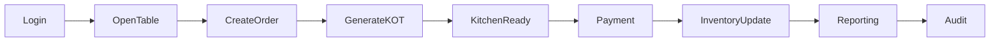

# 11_QA_Test_Cases_02_Integration_and_Regression.md

# Restaurant POS Enterprise Product Bible
## QA Repository – Integration, Regression & Non-Functional Testing

**Module ID:** QA-002

---

# 1. Purpose

Defines end-to-end integration, regression, performance, security, resilience, and release validation scenarios.

---

# 2. End-to-End Integration Flow

---

# 3. Integration Scenarios

## INT-001 Complete Dine-In Journey

Modules:
- Authentication
- POS
- Kitchen
- Payments
- Inventory
- Reporting

Expected:
- Order completes successfully
- KOT generated
- Payment settled
- Inventory consumed
- Sales reflected in reports
- Audit trail complete

---

## INT-002 Procurement to Inventory

Flow:
Purchase Request → Purchase Order → GRN → Inventory Ledger → Stock Available

Validation:
- Ledger updated
- Average cost recalculated
- Reports refreshed

---

## INT-003 Multi-Branch Sync

Expected:
- Branch isolation maintained
- Consolidated reports accurate
- Duplicate IDs prevented

---

# 4. Regression Suite

Critical:
- Login
- Order lifecycle
- KOT
- Billing
- Split payment
- Refund
- Stock receipt
- Stock transfer
- Report generation

High:
- Feature flags
- Notifications
- Printer routing
- Tax engine

---

# 5. API Integration Tests

- JWT validation
- Idempotency
- Pagination
- Rate limiting
- Error responses
- Webhook retries
- Correlation IDs

---

# 6. Performance Tests

| Scenario | Target |
|---|---:|
|Login|<1 sec|
|Create Order|<500 ms|
|Generate KOT|<1 sec|
|Payment|<2 sec|
|Dashboard|<2 sec|

Load Tests
- 1,000 concurrent users
- 10,000 orders/day
- 1M ledger records

Stress Tests
- Peak lunch traffic
- Gateway latency
- Printer queue overload

---

# 7. Security Tests

- SQL Injection
- XSS
- CSRF
- Broken Access Control
- JWT Tampering
- Session Hijacking
- Password Policy
- Secret Exposure

---

# 8. Offline & Recovery

Scenarios:
- Offline order creation
- Offline payment queue
- Reconnect conflict resolution
- Printer recovery
- Event replay
- Database failover

Expected:
- No data loss
- Automatic reconciliation
- Audit continuity

---

# 9. Defect Severity Matrix

| Severity | Description |
|---|---|
|Critical|Release blocker|
|High|Major business impact|
|Medium|Workaround available|
|Low|Minor usability issue|

Priority:
P1, P2, P3, P4

---

# 10. Release Checklist

- Critical tests pass
- Regression completed
- Performance targets met
- Security scan passed
- Audit verified
- UAT approved
- Rollback plan validated

---

# 11. Test Data Strategy

- Synthetic data
- Masked production samples
- Seed datasets
- Repeatable fixtures
- Environment reset scripts

---

# 12. Traceability

Every test maps to:
- Business Rule
- API Endpoint
- Database Entity
- User Story
- UAT Scenario

---

# Next

12_UAT_Scenarios_01_End_to_End_UAT.md
