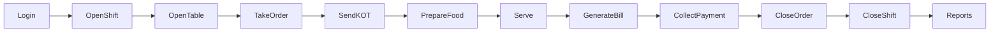

# 12_UAT_Scenarios_01_End_to_End_UAT.md

# Restaurant POS Enterprise Product Bible
## User Acceptance Testing (UAT) – End-to-End Business Validation

**Module ID:** UAT-001

---

# 1. Purpose

This document defines the business acceptance scenarios used by restaurant operators to validate that the complete POS platform satisfies operational requirements before production deployment.

---

# 2. UAT Participants

| Role | Responsibility |
|---|---|
|Restaurant Owner|Business sign-off|
|Store Manager|Operational validation|
|Cashier|Billing validation|
|Waiter|Order workflow validation|
|Kitchen Supervisor|KDS validation|
|Inventory Manager|Stock validation|
|Finance|Settlement validation|
|Product Team|Issue triage|

---

# 3. End-to-End Business Journey

---

# 4. UAT Scenarios

## UAT-001 Restaurant Opening

**Objective**
Verify daily opening procedures.

**Preconditions**
- Store configured
- Users active
- Opening cash available

**Steps**
1. Login
2. Open cashier shift
3. Verify printers
4. Verify kitchen stations
5. Verify menu sync

**Expected Results**
- Shift opens successfully
- Devices online
- Audit entries created

---

## UAT-002 Complete Dine-In Service

**Steps**
1. Open table
2. Add guests
3. Add menu items
4. Send KOT
5. Kitchen prepares order
6. Serve customer
7. Generate bill
8. Accept payment
9. Print receipt
10. Close table

**Acceptance Criteria**
- Correct totals
- Correct KOT routing
- Receipt generated
- Table available again

---

## UAT-003 Split Payment

Expected:
- Multiple tenders accepted
- Totals reconcile
- Receipt reflects tender split

---

## UAT-004 Inventory Replenishment

Flow:
Purchase Request → PO → GRN → Inventory Available

Acceptance:
- Stock updated
- Ledger posted
- Valuation recalculated

---

## UAT-005 Restaurant Closing

Steps
1. Complete pending orders
2. Close shift
3. Reconcile cash
4. Generate daily reports

Expected
- No pending transactions
- Variance calculated
- Reports available

---

# 5. Acceptance Matrix

| Area | Business Owner | Status |
|---|---|---|
|Authentication|IT|Pending|
|POS|Operations|Pending|
|Kitchen|Kitchen Manager|Pending|
|Inventory|Store Manager|Pending|
|Payments|Finance|Pending|
|Reporting|Management|Pending|

---

# 6. Exit Criteria

- All critical UAT scenarios passed
- No Sev-1 defects
- Approved workarounds for remaining issues
- Stakeholder sign-off obtained

---

# 7. Sign-off

| Stakeholder | Signature | Date |
|---|---|---|
|Product Owner|||
|Restaurant Owner|||
|QA Lead|||
|Engineering Lead|||

---

# Next

13_Deployment_Operations_01_Deployment_Playbook.md
