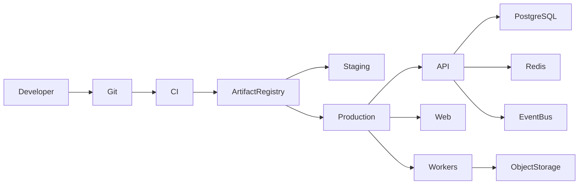

# 13_Deployment_Operations_01_Deployment_Playbook.md

# Restaurant POS Enterprise Product Bible
## Deployment & Operations Playbook

**Module ID:** OPS-001

---

# 1. Purpose

This playbook defines how the Restaurant POS platform is built, deployed, monitored, maintained, and recovered in production.

---

# 2. Environment Strategy

| Environment | Purpose |
|---|---|
| Development | Feature development |
| QA | Functional testing |
| UAT | Business validation |
| Staging | Production rehearsal |
| Production | Live operations |

---

# 3. Deployment Architecture

---

# 4. CI/CD Pipeline

1. Commit & Pull Request
2. Static Code Analysis
3. Unit Tests
4. Security Scan
5. Build Docker Images
6. Publish Artifacts
7. Deploy to QA
8. Automated Regression
9. Deploy to UAT
10. Production Approval
11. Blue/Green or Canary Deployment
12. Post-deployment Health Checks

---

# 5. Release Strategy

- Semantic Versioning
- Release Notes
- Feature Flags
- Zero-downtime deployments
- Controlled rollout by branch

---

# 6. Database Migration

Rules:
- Versioned migrations only
- Backward-compatible schema changes
- Pre-deployment backup
- Rollback scripts mandatory
- Data validation after migration

---

# 7. Rollback Strategy

Triggers:
- Critical defect
- Performance degradation
- Failed health checks
- Database incompatibility

Steps:
1. Stop rollout
2. Switch traffic
3. Restore previous release
4. Validate services
5. Publish incident report

---

# 8. Backup & Disaster Recovery

- Nightly full backup
- 15-minute WAL/incremental backups
- Cross-region backup replication
- Quarterly restore drills

Targets:
- RPO: 15 minutes
- RTO: 60 minutes

---

# 9. Monitoring & Alerting

Metrics:
- API latency
- Error rate
- CPU
- Memory
- Database connections
- Queue depth
- Payment failures
- KDS delays

Alerts:
- Critical
- High
- Warning
- Informational

---

# 10. Security Hardening

- TLS 1.3
- Secrets Manager
- RBAC
- MFA for admins
- WAF
- Audit logging
- Dependency scanning
- Image signing

---

# 11. Production Readiness Checklist

- Infrastructure provisioned
- Secrets configured
- SSL certificates valid
- Monitoring enabled
- Backups verified
- Load test completed
- Security scan passed
- Rollback validated
- Support runbook approved

---

# 12. Operational Runbooks

- API outage
- Database failover
- Payment gateway outage
- Printer outage
- Kitchen service interruption
- Cache flush
- Certificate renewal
- Emergency rollback

---

# 13. KPIs

- Availability ≥ 99.9%
- Deployment success > 98%
- MTTR < 60 min
- Change failure rate < 10%
- Backup success = 100%

---

# Next

14_Future_Roadmap_01_Product_Evolution.md
